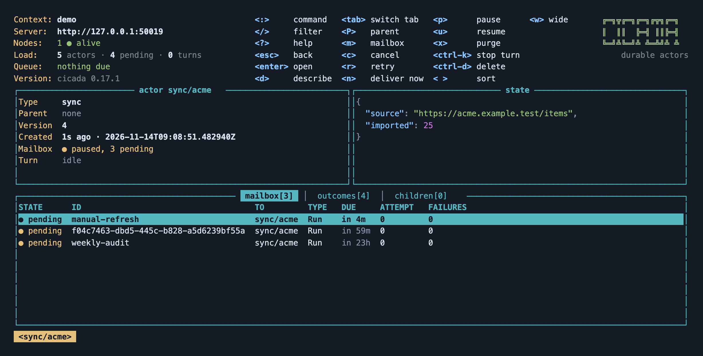

# Cicada for Rust

Durable actors backed by PostgreSQL or SQLite. Each actor has a stored state and a mailbox. Cicada handles one
message at a time and commits its state, outgoing messages and outcome in one transaction.

If a node dies, an [eligible executor](docs/guide/core.md#pin-an-actor-to-an-executor) can run the turn again.
**External calls can happen more than once**: use the message id as their idempotency key. Nodes coordinate through the shared store; actors occupy memory only during a turn.

## Quick start

[Build your first actor](docs/guide/core.md#define-an-actor-type), or try the runnable sample from this checkout:

```sh
cargo run -p cicada-sample-service -- serve --store actors.db
```

In another terminal, create a counter and send it a message:

```sh
export CICADA_SERVER=http://127.0.0.1:8080
cargo run -p cicada-app -- create actor e2e.counter/demo --state '{}'
cargo run -p cicada-app -- send e2e.counter/demo --type Step --payload '{"seq":1}'
cargo run -p cicada-app -- get actor e2e.counter/demo -o json
```

The state’s `count` becomes 1 after the message runs. Keep the API on loopback until you
[add authentication](docs/guide/http.md#run-it-in-an-axum-service).

Inspect actors and their mailboxes with the [terminal UI](docs/guide/app.md#command-line-and-terminal-ui):



## Documentation

[Start here](docs/README.md) for the reading paths. Each guide starts with the task it helps you complete.
Use [Design with actors](docs/guide/design.md) to choose actors, ownership and protocols before writing handlers.

## Layers

| You need | Use | Read |
| --- | --- | --- |
| Actor types, turns, stores and tests | `cicada`, `cicada-test` | [Core](docs/guide/core.md) |
| An HTTP API or typed client | `cicada-axum`, `cicada-client` | [HTTP](docs/guide/http.md) |
| A binary with serve, worker and operator commands | `cicada-app` | [App](docs/guide/app.md) |
| Supervision, scheduling, flows and message processing | `cicada-actors` | [Ready-made actors](docs/guide/actors.md) |
| Traces and metrics | `cicada-otel` | [Telemetry](docs/guide/core.md#opentelemetry) |

## Using a release in another project

The crates are private Git dependencies. Use the **same tag for every Cicada crate**:

```toml
[dependencies]
cicada = { git = "https://github.com/helico-tech/cicada.rs", tag = "v0.20.8" }
cicada-app = { git = "https://github.com/helico-tech/cicada.rs", tag = "v0.20.8", features = ["sqlite"] }
serde = { version = "1", features = ["derive"] }
schemars = "1"
```

[Installation](docs/how-to/install.md) covers repository access, store features, workspaces and CI.
Read the [changelog](CHANGELOG.md) and [upgrade procedure](docs/how-to/upgrading.md) when changing tags.

## Building and testing

Use Rust 1.94 or newer:

```sh
cargo build --workspace
cargo test --workspace
```

[AGENTS.md](AGENTS.md) has the contributor rules and commands, including optional PostgreSQL and Docker tests.
For agents using Cicada in another project, [install the consumer skill](docs/how-to/install.md#install-the-coding-agent-skill)
or start with the [agent reading map](docs/agents.md).
