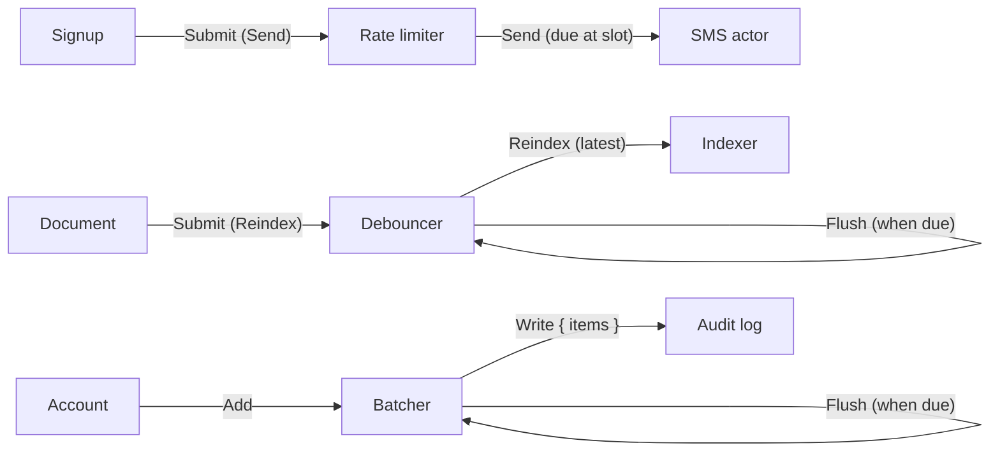
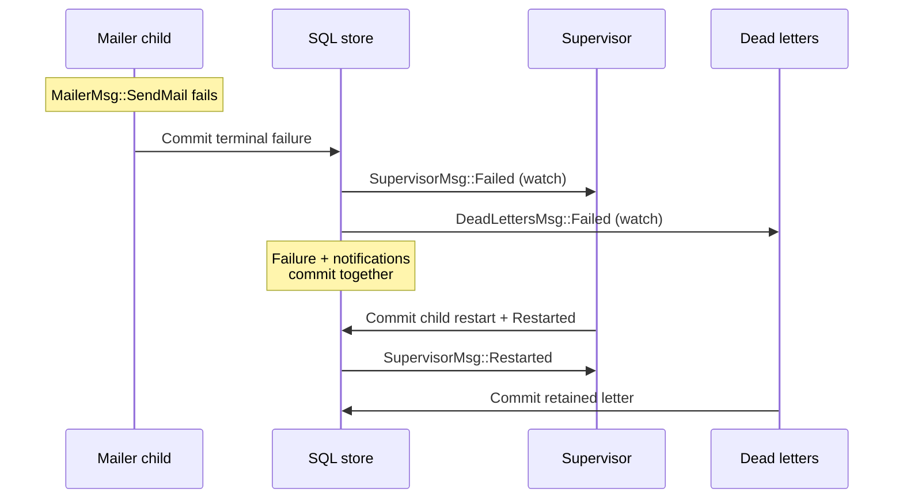
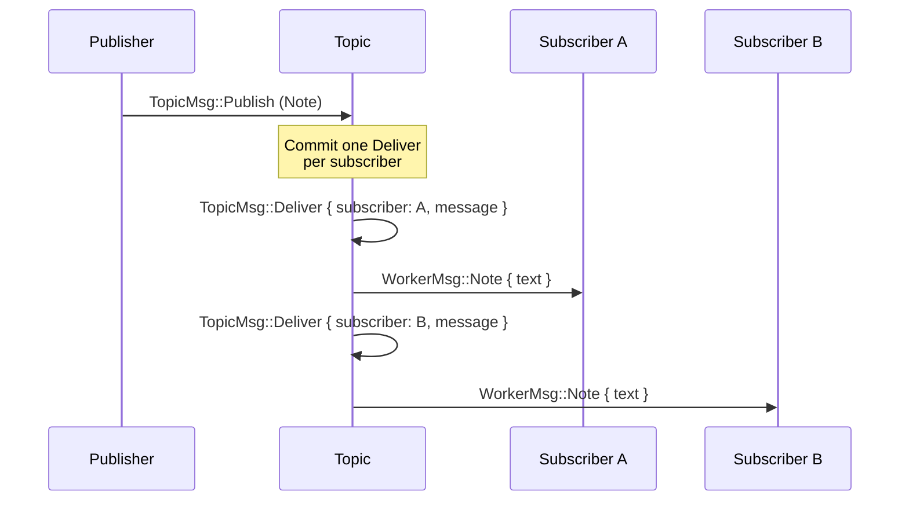
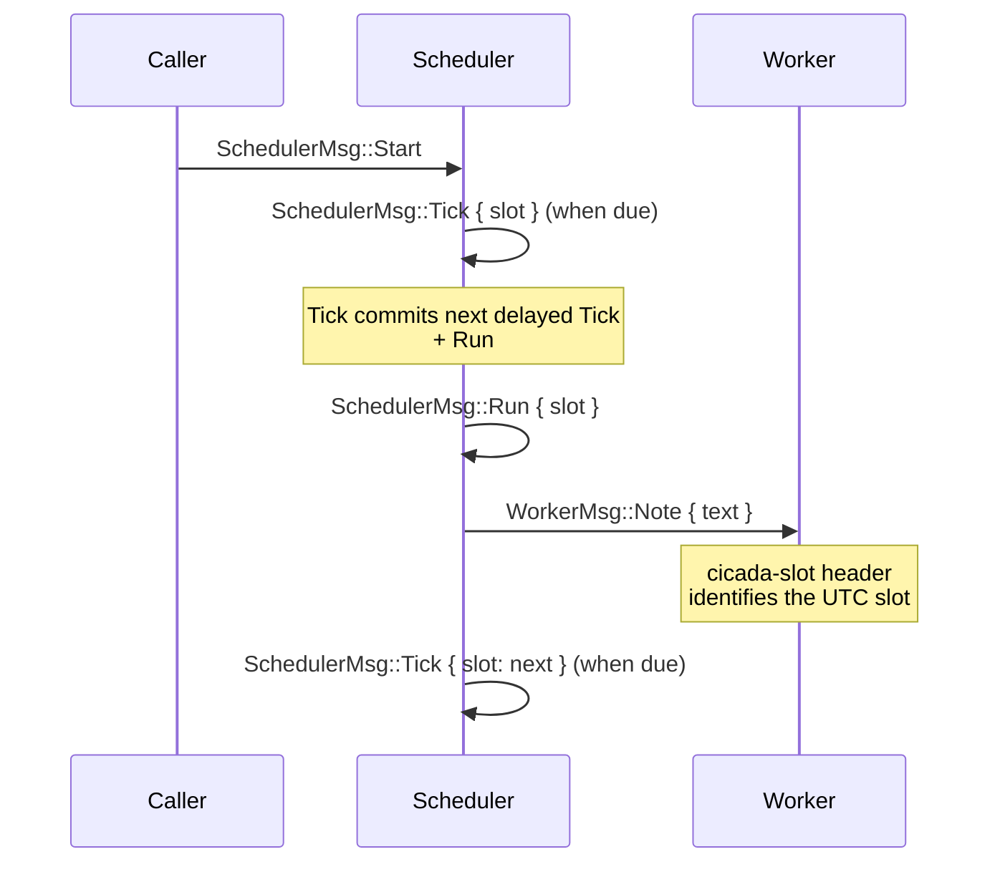
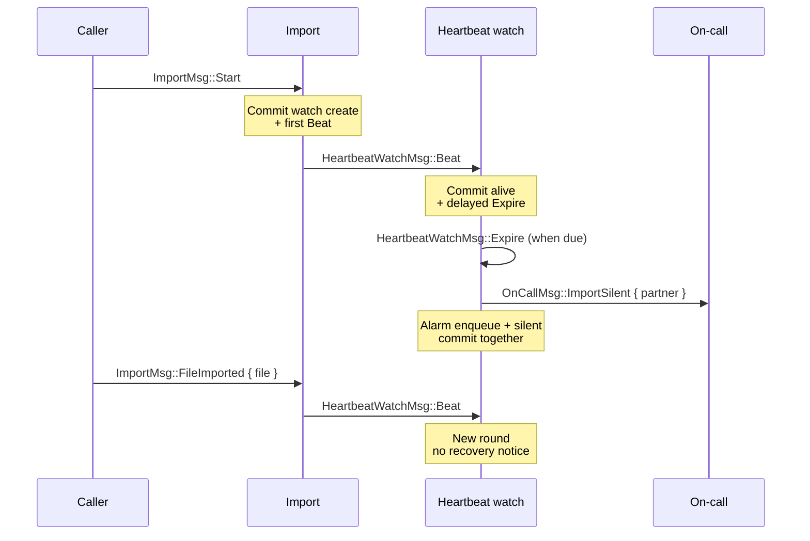
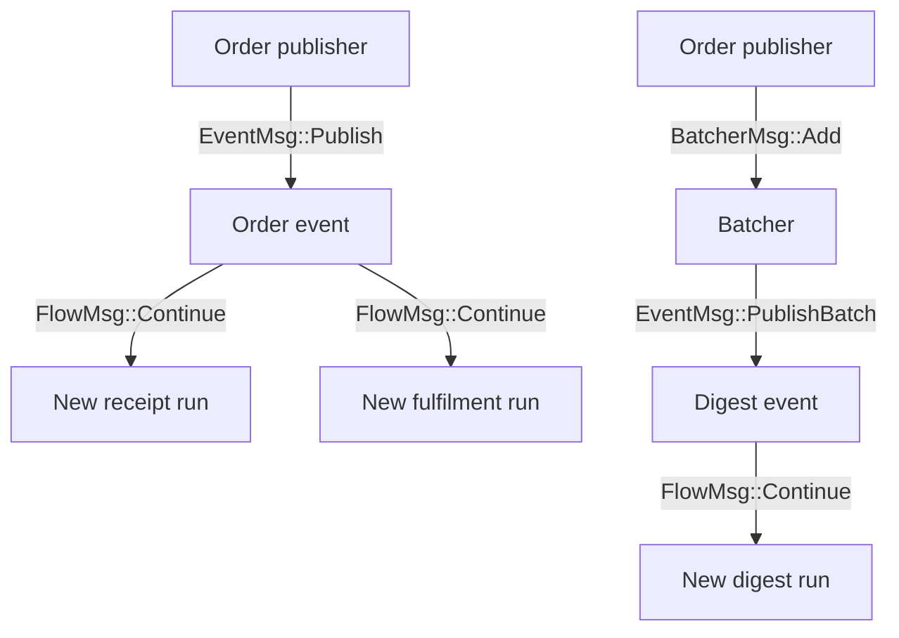

# Ready-made actors: choose a pattern

Host these types from `cicada-actors`, create their instances, then send their public messages.
They use ordinary actor guarantees, watches and control effects from the [core](core.md).

| Need | Actor / type | Complete example |
| --- | --- | --- |
| Restart a child at fault | `SupervisorActor` / `cicada.supervisor` | [supervision](../../examples/src/supervision.rs) |
| Keep and redrive failed messages | `DeadLettersActor` / `cicada.dead-letters` | [supervision](../../examples/src/supervision.rs) |
| Send to existing subscribers | `TopicActor` / `cicada.topic` | [topic tests](../../crates/cicada-actors/tests/) |
| Send at recurring UTC slots | `SchedulerActor` / `cicada.scheduler` | [cron](../../examples/src/cron.rs) |
| Space deliveries at a shared rate | `RateLimiterActor` / `cicada.rate-limiter` | [rate_limit](../../examples/src/rate_limit.rs) |
| Keep the latest value of a burst | `DebouncerActor` / `cicada.debouncer` | [debounce](../../examples/src/debounce.rs) |
| Collect items into one delivery | `BatcherActor` / `cicada.batcher` | [batching](../../examples/src/batching.rs) |
| Notice that something stopped happening | `HeartbeatWatchActor` / `cicada.heartbeat-watch` | [heartbeat](../../examples/src/heartbeat.rs) |
| Tell people a node stopped heartbeating | `NodeDownMonitorActor` / `cicada.node-down` | [node_down](../../examples/src/node_down.rs) |
| Cap how many jobs run at once | `PermitsActor` / `cicada.permits` | [permits tests](../../crates/cicada-actors/tests/permits.rs) |
| Know which nodes offer room, and which went quiet | `PlacementActor` / `cicada.placement` | [placement tests](../../crates/cicada-actors/tests/placement.rs) |
| Run a graph of jobs given as data | `JobGraphActor` / `cicada.job-graph` | [job graph tests](../../crates/cicada-actors/tests/job_graph.rs) |
| Run a durable multi-step job | `FlowActor<F>` / host-chosen name | [flow_onboarding](../../examples/src/flow_onboarding.rs) |
| Start flows from a publication | `EventActor` / `cicada.event` | [flow_events](../../examples/src/flow_events.rs) |

## Shared conventions

Use named refs such as `Scheduler::named("nightly")`; dead letters use `_` by convention.
Creating an existing instance leaves its settings and progress untouched. Pause/resume/delete use the core controls.
A delete drops stored work; already forwarded messages stay in their targets’ mailboxes.

`StoredMessage` holds a type name and JSON payload, without an address. Build it with
`StoredMessage::for_ref(&target, message)` for compile-time message-family checking.
[Contract references](../reference/contracts/) contain the exact state and message formats.

Forwarded deliveries get new ids and the forwarding actor as sender. Put reply addresses in payloads.
A submission’s retry policy governs the forwarding turn; the target’s policy is a separate setting.
Target retries do not pass through a limiter, debouncer or batcher again.

**Due time is a lower bound.** Pauses, queueing, outages and slow commits can make delivery late.
Each turn rewrites the state it changes: keep stored values small or store references to external data.

## Message processing

Choose what should reach the target: accepted messages at reserved due times, the latest value after quiet, or a list.
These are three alternatives, not stages of one pipeline.



Labels are the message variants from [rate_limit.rs](../../examples/src/rate_limit.rs),
[debounce.rs](../../examples/src/debounce.rs) and [batching.rs](../../examples/src/batching.rs):
`RateLimiterMsg::Submit` wraps `SmsMsg::Send`; `DebouncerMsg::Submit` wraps `IndexerMsg::Reindex`;
`BatcherMsg::Add` becomes `AuditLogMsg::Write`. A full batch sends during Add without waiting for Flush.
Due times do not bound execution time; a paused or busy target can run later.

## Supervisor

Use a supervisor only when a child can restart from its configured initial state.
**A restart deletes the old state, descendants and mailbox**; purged messages do not become dead letters.
Do not supervise dead letters or a topic whose subscriptions you must keep.



The two watchers act independently. Restarting does not replay the failed message; an operator redrives its letter.
The diagram assumes a handler fault below the restart limit and both watches already configured.

Build `SupervisorState::new().child(Child::new(&ref, &state)?.start(message)?)`, create the supervisor, then send `Start`.
Each child starts independently in its own `StartChild` turn: create as a child, watch, send its start message.
An actor with another parent or no parent cannot be adopted.

| Child failure cause | Response |
| --- | --- |
| `handler`, `timeout` | Restart that child |
| `state` | Give up without deleting its state; escalate permanently |
| `refused`, `message`, `commit`, `node`, `claim-limit` | Leave it running |

A restart suppresses further failures of the same incident until `Restarted` is handled.
The default limit is 3 restarts in 60 seconds; `restart_limit` changes it. Exceeding it fails a supervisor message
as a handler failure, allowing a parent supervisor to restart its tree. A child that cannot start/read fails a
supervisor message permanently instead. Start attempts use 7 attempts with waits doubling from 1 s (63 s total waits).

Send `Start` again to recover a child that was given up or an interrupted restart. A child that stops/is deleted is
forgotten until a later restart of its supervisor. Only real store notifications drive failure handling; internal
messages count only when self-sent. Host the supervisor with its child types to validate entries before creation.
See [the implementation](../../crates/cicada-actors/src/supervisor.rs) for incident and restart details.

## Dead letters

Create the actor and set its watch explicitly. This is the complete setup for a handler-free example host:

<!-- doctest
@@2
# async fn example(store: cicada::Store) -> Result<(), Box<dyn std::error::Error>> {
@@6
# Ok(()) }
-->
```rust,no_run
use cicada::{ActorRef, ActorSystem, WatchTarget};
use cicada_actors::{DeadLetters, DeadLettersActor, DeadLettersState};

let system = ActorSystem::builder(store).host(DeadLettersActor::with_capacity(1_000)?).build();
system.start().await?;
let letters = DeadLetters::default();
system.create(&letters, &DeadLettersState::default()).await?;
system.watch(&WatchTarget::Every, &letters.address()?).await?;
```

Only store `Failed` notifications create letters. Capacity defaults to 1000, with the oldest dropped first.
Letters keep the message, error, cause, attempts, recorded time and notification sequence.

| Message | Result |
| --- | --- |
| `Redrive { message_id }` (`messageId` on the wire) | Send again with a new id, keeping payload/correlation; record `redrivenAs` |
| `Discard { message_id }` | Forget the letter |

A successful redrive happens once per letter. It does not restore the original sender, retry policy or headers.
An invalid message/type or unreadable payload records `redriveError`; a missing target rejects the commit and leaves
the letter unchanged. A redriven failure becomes a new letter.

Payloads up to 61 levels deep stay in `payload`; deeper accepted payloads use compact JSON in `payloadJson`.
Exactly one field is present. In Rust, `LetterPayload::value()` decodes it on demand with exact numeric rounding.
Redrive applies current send checks; retained text does not make invalid/deep data sendable.
Legacy deep letters need conversion or discard: [upgrade procedure](../how-to/upgrading.md).

## Topic



Here the published message is `WorkerMsg::Note`, as in [the topic tests](../../crates/cicada-actors/tests/topic.rs).
`Publish` and `Deliver` wrap that message; subscribers receive `Note`, not `Deliver`.
Each Deliver is a separate topic turn; neither subscriber is created by the topic.

Create `TopicState::default()`, send `Subscribe { subscriber }`, then `TopicMsg::publish(message)`.
`Publish` creates one self-sent `Deliver` per subscriber, so one broken subscriber does not block the others.
Deliveries carry the publication’s correlation id. Per-subscriber publication order holds unless a delivery is retried.

A missing instance rejects its delivery and the topic drops that subscriber after the failure notification.
An unregistered type or unsupported message permanently refuses delivery but keeps the subscription: unsubscribe it
explicitly. The topic watches itself; forged notifications and non-self-sent deliveries do nothing.
One turn per subscriber per publication makes large fan-outs expensive.
[Source](../../crates/cicada-actors/src/topic.rs) and [wire contract](../reference/contracts/cicada.topic.json).

## Scheduler

Build `SchedulerState::new(schedule, &target, message)`, create the actor, then send `SchedulerMsg::Start`.
A slot takes two turns: `Tick` arms the next tick and queues `Run`; `Run` forwards the currently configured message.

| Message | Use |
| --- | --- |
| `Start` | Start or repair the tick chain; safe to repeat |
| `Run` | Deliver now, even before Start, without moving the tick |
| `Update` | Replace supplied schedule/target/message/retry fields; a changed schedule rearms the tick |



Here the configured target message is `WorkerMsg::Note`, as in [the scheduler tests](../../crates/cicada-actors/tests/scheduler.rs).
Set `state.retry` for failures at the target. Scheduled deliveries carry `cicada-slot` in UTC to the second;
a manual `Run` has no slot. Correlation ids are not forwarded. Internal ticks must be self-sent and armed.

A late tick delivers once, then skips missed slots. A failed Run does not stop future ticks; pause/delete an orphaned
schedule to stop repeated failures. Cancelling/purging the armed tick can stall the chain; send Start to repair it.
A retry/redrive of the old tick does not repair it. Never target the scheduler’s own Run: it creates an endless chain.
[Source](../../crates/cicada-actors/src/scheduler.rs).

### Schedule

`Schedule::every(seconds)` aligns intervals to the Unix epoch. `Schedule::daily(hour, minute)` uses UTC.
`next(time)` returns the first slot strictly after the given time. There are no cron expressions or time zones.

<!-- doctest
@@5
# Ok::<(), Box<dyn std::error::Error>>(())
-->
```rust
use cicada::time::Timestamp;
use cicada_actors::Schedule;

let now: Timestamp = "2026-10-02T10:15:30Z".parse()?;
assert_eq!(Schedule::every(3600)?.next(now), "2026-10-02T11:00:00Z".parse::<Timestamp>()?);
```

For work inside your own actor’s turn, use the [cron example](../../examples/src/cron.rs).

## Rate limiter

Create `RateLimiterState::new(count, period, burst, max_delay)` and send
`RateLimiterMsg::submit(&target, message, target_retry)`.
It reserves a GCRA slot and forwards atomically. Count/burst/period must be positive; max delay may be zero.
The interval rounds up to microseconds, and idle time restores the burst.

A slot exactly at `maxDelay` is allowed; a later slot is refused permanently. The limit counts from handling time,
excluding mailbox wait/commit. A failed forward reserves nothing; cancelling a forwarded message returns no capacity.
Forwarded messages keep the submission’s correlation id but not its headers or retention.

**This shapes due times, not external API calls.** A paused or slow target can run several overdue deliveries close
together. Enforce strict external quotas at the call site. Replace the actor to change settings; existing forwards
keep their slots. [Example](../../examples/src/rate_limit.rs).

## Debouncer

Create `DebouncerState::new(quiet, max_wait)` with `0 < quiet <= maxWait`, then submit through
`DebouncerMsg::submit(&target, message, target_retry)`.
The latest target, message, retry and correlation id replace the previous submission together.
It keeps the trailing value only and checks the target at flush time.

Each submission rearms a timer at `min(now + quiet, firstAt + maxWait)`.
Public `Flush` sends the kept value, cancels the timer and clears the burst in one commit; an empty flush does nothing.
Headers/retention are not copied. A failed flush leaves everything intact; send Flush to recover a lost timer, or
submit a new value to replace the old one. A retried old Flush can flush a newer burst early.
Delete/recreate to change settings. [Example](../../examples/src/debounce.rs).

## Batcher

Create `BatcherState::new(&target, message_type, max_items, max_wait)`; `maxItems` is 1–1000 and max wait positive.
Send `BatcherMsg::add(item)` for each item. The target receives `{ "items": [...] }` in handling order.
Set the state’s `retry` for failures at the target. Item headers/correlation ids are not retained.

The first item arms a Flush timer. Filling the batch, an Add at/after the deadline, or a public Flush sends it and
clears it atomically. A stored batch therefore has fewer than `maxItems` items. A failed flush keeps the batch.
If the final Add cannot send, **that new item is not kept**; recover its failed message separately.

A cancelled/purged/failed timer can leave items stranded. Send Flush to recover; an Add before the old deadline does
not rearm it. A retried old Flush can send a newer batch early. Count limits do not bound bytes; keep items small.
Delete/recreate to change settings. [Example](../../examples/src/batching.rs).

## Heartbeat watch

Create one `HeartbeatWatch::named(...)` per watched thing, using
`HeartbeatWatchState::new(silence, &target, alarm)`. Silence must be positive and at most `MAX_DELAY`;
set `state.retry` for the alarm's target retry policy. Host `HeartbeatWatchActor` alongside the target type.
Settings are fixed: delete/recreate to change them; repeating create changes nothing.

| Message | Effect |
| --- | --- |
| `HeartbeatWatchMsg::Beat` | Set `lastBeatAt` to this turn's store claim time, replace the timer and become `alive` atomically |
| `HeartbeatWatchMsg::Expire` | Only the armed self-sent timer counts: enqueue the alarm and become `silent` atomically; an early timer rearms at the unchanged deadline |
| `HeartbeatWatchMsg::Rearm` | Replace an `alive` round's timer at its original deadline, keeping `lastBeatAt`; no effect in `waiting` or `silent` |

A newly created watch is `waiting`, with no timer. Send a synthetic Beat with creation to notice a thing that never
starts; this reports `alive` before any external activity. **One silence, one alarm:** expiry clears `armed`, keeps
`lastBeatAt` and arms nothing more. The next Beat starts another round without a recovery notification.



[Example 19](../../examples/src/heartbeat.rs) allows 25 hours for a nightly import. The diagram assumes no Beat is
handled before the due Expire. Silence measures handled Beats, not external event or send time: mailbox order
`(deliverAt, seq)` decides a Beat/Expire race. Pauses, outages and slow commits can delay the alarm. It means one
committed enqueue per round; target handling/retries are independent and may repeat external effects.

**Recover a lost timer with Rearm.** Purge, pending cancellation or terminal timer failure can leave `alive` with a
stale `armed`: it proves neither a pending timer nor external health. Fix the cause, then send Rearm; an overdue
deadline becomes due immediately. It also replaces a retrying timer. Operator retry/redrive creates a new id and is
ignored, as are forged or superseded Expires. Ordinary policy retries keep the armed id. A Beat resets the deadline
and claims new activity; Rearm preserves the round. Purge/pending cancel sends no failure notice.

An unregistered target type or unsupported message permanently refuses expiry; a missing target rejects its commit.
A failed store read uses the timer's seven-attempt retry policy (1–32 s waits). Known rejected turns save no alarm or
state effects; uncertain acknowledgements follow ordinary core recovery. Target payload decoding can fail later,
after the watch is already silent. Active actions refuse a self-target; ignored messages remain no-ops.

Alarms have a fresh id, the watch as sender, the configured retry policy and no correlation id; normal observer
headers still apply. Alarm payloads may be at most 62 levels deep in a new watch state. Typed decoding checks round
consistency and deadline bounds; raw HTTP schema validation alone does not. See the
[wire contract](../reference/contracts/cicada.heartbeat-watch.json) and
[implementation](../../crates/cicada-actors/src/heartbeat_watch.rs) for exact fields and checks.

## Node-down alerts

Use one unpinned `NodeDownMonitor` (`cicada.node-down/_`) per store to publish observed node silence through a
[Topic](#topic). Unlike [Heartbeat watch](#heartbeat-watch), which counts explicit Beats from your jobs or devices,
this monitor reads Cicada's native node table. Nothing creates or starts it automatically.

1. Build a reader `ActorSystem` on the same store; never start it, so it writes no node row or heartbeat.
2. Host `NodeDownMonitorActor::new(reader)`, `TopicActor` and the receiver types. Every monitor host must read that
   same store.
3. Create the topic with `TopicState::default()` and subscribe the receivers with `TopicMsg::Subscribe`.
4. Create `NodeDownMonitor` unpinned with `NodeDownMonitorState::new(topic)?`, then send `NodeDownMonitorMsg::Rearm`.

[Example 22](../../examples/src/node_down.rs) supplies `start` for steps 3–4, including a pager that watches the
monitor. This host uses that setup; the example pager records at most 100 lines rather than contacting people:

<!-- doctest
# async fn example(store: cicada::Store) -> Result<(), Box<dyn std::error::Error>> {
@@12
# Ok(()) }
-->
```rust,no_run
use cicada::ActorSystem;
use cicada_actors::{NodeDownMonitorActor, TopicActor};
use cicada_examples::node_down::{PagerActor, start};

let reader = ActorSystem::builder(store.clone()).build(); // never start this reader
let system = ActorSystem::builder(store)
    .host(NodeDownMonitorActor::new(reader))
    .host(TopicActor)
    .host(PagerActor)
    .build();
system.start().await?;
start(&system).await?;
```

| Message | Effect |
| --- | --- |
| `NodeDownMonitorMsg::Rearm` | Start or replace the timer at the saved `nextPollAt`, due now on first start or when overdue; keep `alerted` |
| `NodeDownMonitorMsg::Poll` | Only the armed self-sent timer counts: read, publish new episodes and arm the next poll; an early timer rearms at the same time without reading |

Each due poll bounds its read to five seconds; the next is due ten seconds after the check ends. Pauses, outages
and queueing can delay it. A node row is dead when sample time minus `lastSeen` is **at least 120 seconds**. A row
already dead at the first check alerts too. Enqueues of `TopicMsg::Publish`, watermarks in `alerted`,
`lastCheckedAt` and the next timer commit together, so competing hosts or a replay do not duplicate a kept observation.

For each still-dead node id, `alerted` keeps its `(startedAt, lastSeen)` watermark. The same pair alerts no more
while kept; a newer heartbeat or a different `startedAt` alerts again once dead, even without an alive sample in
between. A successful check forgets absent and alive rows silently, with no recovery message. Deleting and recreating
the monitor resets this history.

Receivers declare `NodeDown(cicada_actors::NodeDown)` in a `#[serde(tag = "type")]` message family. The wire payload
contains `node`, `startedAt`, `lastSeen`, `detectedAt` and optional `hostname`, `cicadaVersion`, `label`.
`detectedAt` is the sample time, not the time of death. Topic chooses subscribers when it handles `Publish` and
checks membership again at `Deliver`. Successful publication proves neither receiver handling nor that anyone was paged.

Check both parts of the monitor's health:

- **Watch for `Failed` and `Stopped`.** A missing topic rejects a poll's whole commit (cause `commit`), keeping no
  alert or state changes and losing the timer. Recreate the topic and subscriptions, then send `Rearm`. Purge or
  cancellation can also lose the timer without notifying a watcher. Retry/redrive copies, forged polls and superseded
  timers do nothing; use `Rearm`, which preserves history. Recreate a deleted monitor before rearming it.
- **Read `lastProblem` and `lastCheckedAt`.** Failed reads record `unavailable`, `timeout`, `invalid` or `tooManyNodes`
  and keep polling; these turns succeed, so watches say nothing. One invalid row, backwards sample time or more
  than 1000 rows rejects the whole sample: no alerts, with `alerted` and `lastCheckedAt` unchanged. A good sample
  clears `lastProblem`. The example's `read_problem` exposes it; `repair` restores the topic/subscription and rearms.

These are sampled observations, not proof of machine failure. Clean-stop removal and pruning can hide a row before
it is read; a heartbeat can race an alert; shared node ids share a row; HTTP workers have no row. A cluster with no
working store and polling monitor cannot alert. Never use an alert to move pins, claim work or fence outside effects.
The 1000-row cap bounds retained state, not the full node-table read; slow reads can suppress alerts indefinitely.

See the [wire contract](../reference/contracts/cicada.node-down.json),
[implementation](../../crates/cicada-actors/src/node_down.rs) and
[tests](../../crates/cicada-actors/tests/node_down.rs) for exact checks and recovery cases.

## Permit pool

Use a permit pool to cap how many jobs run at once across actors: a build farm, licensed workers, a machine with room
for N containers. One `PermitsActor` per pool (`Permits::named("builders")`, type `cicada.permits`) lets at most its
capacity of requests hold a permit; the rest wait in FIFO order. Each grant carries a number that only goes up per
pool, so the resource you guard can refuse work under an older number ([ADR 0058](../adr/0058-a-ready-made-permit-pool.md)).

1. Host `PermitsActor` (no settings) and create the pool with `PermitsState::new(capacity, max_waiting)`, each 0
   through 1,000. A capacity of 0 pauses the pool. Creating a pool that exists changes nothing; `maxWaiting` changes
   only by delete and create.
2. Ask with a fresh request ID per attempt, such as `<job>-<attempt>`, and name the message type of the notices. The
   holder's family takes that type with a `PermitNotice`:

<!-- doctest
# use cicada::prelude::*;
# use serde::{Deserialize, Serialize};
# #[derive(Debug, Clone, Serialize, Deserialize)]
# struct Build { id: String }
# impl ActorRef for Build { const TYPE: &'static str = "build"; type Message = BuildMsg; }
# #[derive(Debug, Default, Serialize, Deserialize, JsonSchema)]
# struct BuildState { grant: Option<u64> }
@@9
# struct BuildActor;
# impl Actor for BuildActor {
# type Ref = Build;
# type State = BuildState;
@@12
# }
-->
```rust
use cicada_actors::{PermitNotice, PermitNoticeKind, Permits, PermitsMsg};

#[derive(Debug, Serialize, Deserialize, JsonSchema)]
#[serde(tag = "type")]
enum BuildMsg {
    Begin { attempt: u32 },
    Permit(PermitNotice),
}

async fn handle(&self, turn: &mut Turn<Self>, message: BuildMsg) -> HandlerResult {
    match message {
        BuildMsg::Begin { attempt } => {
            let request = format!("{}-{attempt}", turn.self_ref().id);
            let acquire = PermitsMsg::acquire(request, turn.self_ref(), "Permit")?;
            turn.send(&Permits::named("builders"), acquire)?;
        }
        BuildMsg::Permit(notice) if notice.kind == PermitNoticeKind::Granted => turn.state_mut().grant = notice.grant,
        BuildMsg::Permit(_) => {} // queued, refused or check: see the table
    }
    Ok(())
}
```

| Notice `kind` | What the holder does |
| --- | --- |
| `granted` | Start the work. Keep `grant` and pass it to the resource you guard |
| `queued` | Wait for `granted`; a repeated `Acquire` keeps the place in the queue |
| `refused` | The queue was full and nothing was recorded: try later or give up |
| `check` | An `Audit` asks. Release if the work is confirmed stopped, cancel if you gave up waiting, ignore it while working. Never start work on a `check` |

3. When the work ends, send `PermitsMsg::Release { request, grant }`. A release with another grant number is ignored,
   so a late release of an earlier grant frees nothing.

Other messages: `Cancel { request }` takes a waiting request out of the queue and is ignored for a holder.
`Resize { capacity }` grants to the queue on a growth and revokes nothing on a shrink; new grants then wait until fewer
hold than the capacity. `Audit` sends a `check` to every request in the books and frees nothing; it skips a holder
that has not been told of its grant yet.

**What frees a permit.** Only a `Release` with the current grant number, or a grant notice that failed before it ever
reached its holder. No timeout frees a permit. A holder deleted after it got its number keeps the permit: release
before you delete a holder, or have an operator send `Release` with the number read from the pool's state. A `Cancel`
that loses the race to its grant does nothing; the holder then gets `granted` for a request it cancelled, and must
release it.

Every `Acquire` is answered in its own commit, so an `Acquire` whose target is gone records nothing. A repeated
`Acquire` answers the first `Acquire`'s target with the same grant. A request ID is forgotten at its release: reusing
it asks a new permit. Grants made later (by a release, cancel or resize) and each `check` go out in a turn of the
pool's own (`Notify`), so a holder that is gone fails only its own notice; each such notice costs the pool one more
turn. Bad input is refused for good with the state unchanged: a capacity above 1,000, a request ID that is empty,
over 200 characters or holds a NUL, a message type out of bounds, a target whose type is not registered or does not
take the message type.

One permit per `Acquire`; there are no priorities, weights or expiry. See the
[wire contract](../reference/contracts/cicada.permits.json),
[implementation](../../crates/cicada-actors/src/permits.rs) and [tests](../../crates/cicada-actors/tests/permits.rs).

## Placement pool

Work that must run on a particular kind of machine needs to know which nodes offer room. A placement pool,
`cicada.placement/<pool>` (from 0.24.0, [ADR 0067](../adr/0067-a-placement-pool.md)), keeps what each node offers:
its labels, such as the processor kind or `docker`, and its number of places, renewed at an interval. A node that stops
offering is marked silent and gets no new places, and the pool's alert target hears of it once. Work asks the pool for
a place with its needs, labels a node must have, and gets the node to [pin](core.md#pin-an-actor-to-an-executor) its
actors to; it releases the place with its grant number when done.

1. Host `PlacementActor` (no settings) and create each pool with
   `PlacementState::new(silence, max_nodes, max_waiting, max_holders)`: silence 1 second through 1 day, 1 through
   1,000 nodes; the line holds 0 through 1,000 waiting asks, the pool 1 through 1,000 holders. The settings are fixed
   at the create; creating a pool that exists changes nothing.
2. Send `PlacementMsg::alerts(&target, message_type)` to say where notices go; the last one stands, and without one no
   notices are sent.
3. From each member, send `PlacementMsg::offer(node, instance, labels, places)` at an interval well below the silence,
   such as every 15 s for a silence of 60 s, while its runtime answers.
4. From the work, send `PlacementMsg::ask(holder, needs, &target, message_type)`, and when it is done
   `PlacementMsg::release(holder, grant)`.

This example hosts a pool and an operator actor on virtual time: one offer, an ask that is granted and released, then
silence:

<!-- doctest
# use std::time::Duration;
# use cicada::prelude::*;
# use cicada_test::TestActors;
# use serde::{Deserialize, Serialize};
# #[derive(Debug, Clone, Serialize, Deserialize)]
# struct Ops;
# impl ActorRef for Ops { const TYPE: &'static str = "ops"; type Message = OpsMsg; }
@@11
# #[derive(Debug, Default, Serialize, Deserialize, JsonSchema)]
# struct Notices { seen: Vec<PlacementNotice>, answers: Vec<PlacementAnswer> }
# struct OpsActor;
# impl Actor for OpsActor {
#     type Ref = Ops;
#     type State = Notices;
#     async fn handle(&self, turn: &mut Turn<Self>, message: OpsMsg) -> HandlerResult {
#         match message {
#             OpsMsg::Placement(notice) => turn.state_mut().seen.push(notice),
#             OpsMsg::Placed(answer) => turn.state_mut().answers.push(answer),
#         }
#         Ok(())
#     }
# }
# #[tokio::main(flavor = "current_thread", start_paused = true)]
# async fn main() -> Result<(), Box<dyn std::error::Error>> {
@@20
# Ok(())
# }
-->
```rust
use cicada_actors::{
    Placement, PlacementActor, PlacementAnswer, PlacementAnswerKind, PlacementMsg, PlacementNotice, PlacementNoticeKind,
    PlacementState,
};

#[derive(Debug, Serialize, Deserialize, JsonSchema)]
#[serde(tag = "type")]
enum OpsMsg {
    Placement(PlacementNotice),
    Placed(PlacementAnswer),
}

let test = TestActors::builder().with(|node| node.host(PlacementActor).host(OpsActor)).build().await?;
test.create(&Ops, &Notices::default()).await;
let pool = Placement::named("runners"); // cicada.placement/runners
test.create(&pool, &PlacementState::new(Duration::from_secs(60), 1000, 100, 1000)?).await;
test.send(&pool, PlacementMsg::alerts(&Ops, "Placement")?).await;

// A member offers; `instance` is drawn at each process start.
test.send(&pool, PlacementMsg::offer("factory-mac-1", "3f9c", ["arm64", "docker"], 4)?).await;
// Work asks for a node with both labels; the answer goes to the target as `Placed`.
test.send(&pool, PlacementMsg::ask("run-17", ["arm64", "docker"], &Ops, "Placed")?).await;
test.run_until_idle().await;
let answer = test.state::<_, Notices>(&Ops).await.answers.remove(0);
assert_eq!((answer.kind, answer.node.as_deref()), (PlacementAnswerKind::Granted, Some("factory-mac-1")));
test.send(&pool, PlacementMsg::release("run-17", answer.grant.unwrap())?).await; // the work is done

test.advance_time_by(Duration::from_secs(61)).await; // no offer within the silence

let seen = test.state::<_, Notices>(&Ops).await.seen;
assert_eq!((seen[0].node.as_str(), seen[0].kind), ("factory-mac-1", PlacementNoticeKind::Silent));
```

**Offers.** `node` is the id the member's node pins its actors under, and `instance` an id the member draws at each
process start, so two processes offering under one node id can be told apart; each is 1 through 200 characters, not
blank, without NUL. Up to 32 labels of 1 through 100 characters are kept sorted and once; 0 through 1,000 places, where
0 keeps the node known but full. Each offer replaces the node's entry and records the store time of its turn as
`heardAt`.

**Silence.** The pool arms one `Check` to itself at the earliest end of a live node's silence (`heardAt` plus the
silence), keeping its time in `armed` and its id in `armedId`. At the check each node past it becomes `silent`. Only
the armed check counts: one made due early by an operator marks nothing and arms itself again at the same time. A
silent node's next offer makes it `live` again. Silence counts from the store time an offer was handled, so a paused or
slow pool marks a node late, never early.

**Alerts.** The target's family takes a variant such as `Placement(PlacementNotice)`, with the kind `silent` once per
silence and `back` when a silent node offers again. Each notice goes out in a turn of the pool's own (`Alert`), so a
target that is gone or does not take the message fails only that alert; the node stays silent.

**Asks.** `holder` names this attempt (1 through 200 characters, no NUL) and is unique among the pool's holders and
waiting asks: use a fresh one per attempt. Up to 32 needs of 1 through 100 characters are kept sorted and once. The
target's family takes the answer under the message type, such as `Placed(PlacementAnswer)`, in the ask's commit, so an
ask whose target is gone fails and records nothing. A node fits when it is live, has every need and has a free place
(its offered places minus its holders); the one with the most free places wins, ties going to the smaller node id.

| Answer `kind` | Meaning |
| --- | --- |
| `granted` | With `grant` and `node`: pin the work's actors to that node and keep the grant number |
| `queued` | The ask waits in the line |
| `refused` | With `reason`: `noNode` (no node of the pool, live or silent, has every need), `lineFull` (it must wait and the line is full) or `poolFull` (a place fits, but the pool holds `maxHolders` and the line is full) |
| `gone` | Later, with `grant` and `node`: an operator declared the holder's node gone; see below. Match it too if you match the kinds exhaustively |

A repeated ask of a holder answers `granted` again with the same grant and node, one of a waiting ask `queued`; both
keep the first ask's needs and target.

**The line.** An ask that only silent or full nodes could meet, or one that comes while the pool holds `maxHolders`,
waits. After every message the pool grants waiting asks in line order, but skips asks it cannot place now, so an ask
for a rare label does not hold up the others ([ADR 0068](../adr/0068-asks-in-the-placement-pool.md)); fairness is
therefore not strict. A grant from the line is told in a turn of the pool's own (`Notify`); if that answer cannot be
delivered, the place is freed again. A waiting ask stays until it is granted or cancelled, also when no node has its
needs any more, as a node may come back; there is no time limit, so send `Cancel` yourself when you need one.

**Releasing.** `PlacementMsg::release(holder, grant)` frees the place only when holder and grant match, so a late
release of an older grant frees nothing. `PlacementMsg::cancel(holder)` withdraws a waiting ask and does nothing for a
holder.

**A deleted holder.** The pool watches the target of each holder and waiting ask with
[`watch_existing`](core.md#watches) while it holds or waits. When that actor is deleted, also before the pool recorded
its ask, every place held for it is freed and its waiting asks leave the line, once; freed places go to the line as
after a `Release`. So a holder actor need not release before it stops, but one that ends its work and lives on still
releases: only the target's delete frees its places. Places are freed per target, so two holders whose answers go to
one actor are both freed when it goes. The watch also tells the pool of every failed message of a target, each one an
ignored turn, so a target with many failing messages adds load. An ask whose target is the pool itself is refused for
good. The pool keeps at most one watch per distinct target, and only a `Stopped` the store wrote counts: one a client
sends changes nothing.

**Taking a node out of service.** Send `PlacementMsg::drain("factory-mac-1")?` to stop new places on a node while its
running work finishes. A draining node keeps its holders and its offers, and its own offers do not clear the drain, so
it outlives a restart of the member. Asks that only that node could meet wait in the line.
`PlacementMsg::undrain("factory-mac-1")?` gives it places again and grants the waiting asks that fit.

When a node's machine will not come back, declare it gone once its status is `silent`:
`PlacementMsg::gone("factory-mac-2")?`. The pool removes the node, frees its places and tells each of its holders a
`gone` answer with its `grant` and `node`, each in a turn of its own, so a holder whose target is gone fails only its
own answer. The holder decides: start the work again elsewhere with a fresh holder id, or fail it. A later `Release` of
that grant frees nothing, and waiting asks stay in the line. `Gone` of a live node is refused, also one past its silence
whose check has not run yet: drain it instead. The node offering again is a new node, not draining and without holders.
Drain, undrain or gone of an unknown node is refused for good.

- `gone` means "your place is no longer counted": what ran there may still run, for example when the machine was only
  cut off. A holder that starts again elsewhere must cope with two copies of the work.
- A holder granted from the line but not yet told can hear `gone` for a grant it never saw, and its `granted` answer
  then never comes: handle a `gone` for an unknown grant.

**Fewer places.** An offer with fewer places than holders keeps every holder, and new grants wait until holders
release; a silent node keeps its holders too.

**A lost check.** A purged, cancelled or failed `Check` leaves the pool without a timer. Anyone may send `Rearm`, which
replaces the armed check at the old time, at once when that passed, so repeated `Rearm`s leave one check. A `Check` or
`Alert` from anyone but the pool is refused for good, an operator's retry or redrive of a `Check` included, and so
are a `Notify` and a `TellGone`.

The pool answers no query: read its state like any actor's, with `ActorSystem::get_actor`, the operator commands or
the terminal UI. A message out of bounds, and an offer from a new node when the pool knows `maxNodes` nodes, is refused
for good with the state unchanged; a known node can always renew. Mind these limits:

- Do not host the pool only on its member nodes: when they all go quiet, nobody runs the check, so nobody is told.
- Keep pools small and intervals gentle. At the bounds (1,000 nodes with 32 long labels each) the state is about
  3 MB, rewritten at each offer, and 1,000 nodes every 15 s is about 67 turns a second on one actor.

See the [wire contract](../reference/contracts/cicada.placement.json),
[implementation](../../crates/cicada-actors/src/placement.rs) and [tests](../../crates/cicada-actors/tests/placement.rs).

## Job graph

Use a job graph when the caller supplies the steps and their dependencies as data, and wants to inspect, cancel and
retry them job by job: a CI pipeline, media processing, an import. One `JobGraphActor` per run
(`JobGraph::named("run-7")`, type `cicada.job-graph`) starts each job once every job it needs succeeded, up to an
in-flight limit, takes one result per attempt and reports the run's end to a target. When the steps are fixed and
written as code, use a [flow](#flows) instead. ADRs [0059](../adr/0059-a-ready-made-job-graph.md),
[0060](../adr/0060-cancel-and-skipped-dependents-in-the-job-graph.md) and [0061](../adr/0061-retry-in-the-job-graph.md) record the decisions.

### Start a run

Host `JobGraphActor` (no settings) beside the worker and report types. Create the run with its graph and send `Start`
in one turn, so a run never exists without its start:

<!-- doctest
# use cicada::prelude::*;
# use serde::{Deserialize, Serialize};
# use cicada_actors::{JobGraphEnd, JobStart};
# #[derive(Debug, Clone, Serialize, Deserialize)]
# struct Builder { id: String }
# impl ActorRef for Builder { const TYPE: &'static str = "builder"; type Message = BuilderMsg; }
# #[derive(Debug, Serialize, Deserialize, JsonSchema)]
# #[serde(tag = "type")]
# enum BuilderMsg { Build(JobStart) }
# #[derive(Debug, Clone, Serialize, Deserialize)]
# struct Ci { run: String }
# impl ActorRef for Ci { const TYPE: &'static str = "ci"; type Message = CiMsg; }
# #[derive(Debug, Serialize, Deserialize, JsonSchema)]
# #[serde(tag = "type")]
# enum CiMsg { GraphEnded(JobGraphEnd) }
# struct CiActor;
# impl Actor for CiActor {
# type Ref = Ci;
# type State = NoState;
# async fn handle(&self, turn: &mut Turn<Self>, _: CiMsg) -> HandlerResult {
@@12
# Ok(())
# }
# }
-->
```rust
use cicada_actors::{Job, JobGraph, JobGraphMsg, JobGraphState};
use serde_json::json;

let ci = turn.self_ref().clone();
let builder = Builder { id: "pool-a".into() };
let jobs = vec![
    Job::new("build", &builder, "Build", json!({"ref": "main"}))?,
    Job::new("test", &builder, "Build", json!({"suite": "all"}))?.with_needs(["build"]),
];
let run = JobGraph::named(ci.run.clone());
turn.create(&run, &JobGraphState::new(jobs, 2, &ci, "GraphEnded")?)?;
turn.send(&run, JobGraphMsg::Start)?;
```

The constructor and the decoder refuse a bad graph, so it never becomes a run: a cycle (named by one of its jobs), a
need that names no job, is repeated or names the job itself, a repeated name, no jobs or more than 100, a name that
is not 1–64 ASCII letters, digits, `-`, `_` or `.`, a message, cancel or report type that is empty, over 200
characters or holds a NUL, an input over 16 KiB as JSON or deeper than 32 levels, and an in-flight limit outside
1–100. The graph is fixed for the run.

`Start` starts every ready job in graph order while fewer than `maxInFlight` run; a second `Start` changes nothing.
The limit counts the run's own running jobs; for a limit across runs, let the workers take a [permit](#permit-pool).

### Do the work

A job is a message to its target: the worker's family takes the job's message type with a `JobStart { run, job,
attempt, input }`, such as `Build(JobStart)`. Any actor can be a worker (a host actor, a flow, a container actor), and
one graph can mix types. The worker answers the run with `JobGraphMsg::succeeded(&start, output)` or
`JobGraphMsg::failed(&start, reason)`; the reason is cut to 2,000 characters.

<!-- doctest
# use cicada::prelude::*;
# use serde::{Deserialize, Serialize};
# use cicada_actors::JobStart;
# #[derive(Debug, Clone, Serialize, Deserialize)]
# struct Builder { id: String }
# impl ActorRef for Builder { const TYPE: &'static str = "builder"; type Message = BuilderMsg; }
# #[derive(Debug, Serialize, Deserialize, JsonSchema)]
# #[serde(tag = "type")]
# enum BuilderMsg { Build(JobStart) }
# struct BuilderActor;
# impl Actor for BuilderActor {
# type Ref = Builder;
# type State = NoState;
# async fn handle(&self, turn: &mut Turn<Self>, message: BuilderMsg) -> HandlerResult {
# let BuilderMsg::Build(start) = message;
@@4
# Ok(())
# }
# }
-->
```rust
use cicada_actors::{JobGraph, JobGraphMsg};

let result = JobGraphMsg::succeeded(&start, serde_json::json!({"artifact": "app.tar"}))?;
turn.send(&JobGraph::named(start.run.clone()), result)?;
```

Only a result that names a running job's current attempt is taken. Any other (an unknown job, a job that is not
running, another attempt, a late result) is refused for good with the state unchanged, and the store keeps it as a
failed message of the run, which [dead letters](#dead-letters) can keep. The sender is not checked, so a worker may
hand the work on to whoever reports. Key outside work by run, job and attempt.

Each job message goes out in a turn of the run's own (`Dispatch`). A gone target, a type no node registers, or a type
that does not take the message fails only that attempt, with the reason
`the job message was not sent (<cause>): <error>`, and the run goes on. The run watches itself, so every refused
`Result` or `Report` and every failed `Dispatch` costs it one more turn.

### Failures and skipped jobs

A failed job skips every waiting job that needs it, directly or through others: each becomes `skipped`, without an
attempt, in the commit of the failure. Jobs that do not need it still run, and ready jobs start after every change of
a job's status.

The run watches each job's target from the turn that sends the job message, and unwatches it once none of its running
jobs has it. A job ends `failed`:

- when its job message fails at the worker (the handler failed until its retries ran out, or refused it), with the
  reason `the job message failed at the worker (<cause>): <error>`;
- when its worker goes away (it stopped itself, was deleted or was removed with its parent), with the reason
  `the worker went away (<cause>)`. Every running job dispatched to that worker ends so.

Other failures of a shared worker change no job; each is one ignored turn of the run. Notifications a client sends
change nothing.

**What the run cannot see.** Work the worker handed on to another actor; a worker that took the job message and then
lost its outside work without failing a message, stopping or reporting; the failure of a later message of the worker.
Such a job stays `running`: give it your own deadline and send `Cancel`. So a target must stay until its job reports;
one that hands work on and then stops itself fails its job. A `Stopped` does not say which incarnation went away, so a
target deleted and created again before the run handles it fails a job dispatched to the new one. A worker that
reports and stops in one turn normally has its result taken, but when the run's turn on that result is rescheduled,
the `Stopped` overtakes it: the job ends `failed` and you can [retry](#retry-a-job) it.

### Cancel jobs

Send the run `JobGraphMsg::Cancel { job: Some("build".into()) }` to cancel one job, or `Cancel { job: None }` for the
whole run. Waiting and running jobs become `cancelled` in that commit; a running job's attempt ends with outcome
`cancelled` and reason `cancelled`. In the same commit the cancelled job's dependents are skipped, ready jobs start in
the freed slots, and the run may end. Ended and skipped jobs, and an ended run, are left alone, so cancelling twice
is harmless; an unknown job name is refused for good.

To tell a running worker, give the job a cancel message type, `Job::new(...)?.with_cancel_type("CancelBuild")`, and
let the worker's family take it: `enum BuilderMsg { Build(JobStart), CancelBuild(JobCancel) }`. A cancelled job whose
job message was sent is told in a later turn of the run (`SendCancel`), with `JobCancel { run, job, attempt }` and the
shared retry policy; a gone worker fails only that message, and the job is `cancelled` already. The worker stops the
work of that attempt only.

A job without a cancel type is not told: its outside work goes on, and its late result is refused. A job cancelled
before its job message was sent gets neither message. Cancel tells only the job's own target; a worker that handed
the work on passes the cancel along. A worker can get `JobCancel` before the `JobStart` of the same attempt, when its
turn on the job message is rescheduled: keep the cancelled attempts you saw and ignore their job messages.

### Retry a job

Send the run `JobGraphMsg::Retry { job: "test".into() }` to run a `failed` or `cancelled` job again. It waits again,
with its output cleared and its attempts kept, and starts with the next attempt number once its needs succeeded and a
slot is free, in the same commit when it can. The jobs skipped only because of it wait again too; a job that also
needs another failed or cancelled job stays skipped. An ended run goes back to `running`.

A `Retry` is refused for good with the state unchanged for an unknown job, a job that is not `failed` or `cancelled`,
and a job with a `failed`, `skipped` or `cancelled` need: retry the need first, as the reason says. The job graph has
no retry policy of its own and no cap: a host that retries automatically sends `Retry` from its own code, for example
from its report target on a failed end, and keeps its own count. A run keeps the last 20 attempts of each job.

A result of a replaced attempt is refused, so a worker always names the attempt of its `JobStart`. The cancel of a
replaced attempt can arrive after the `Retry`, even after the new attempt's `JobStart`: it must stop only that old
attempt's work. After many fast retries, an old attempt can drop out of the 20 kept before its cancel goes out; then
it is never sent.

### The end report

When no job runs and none can start, the run ends `succeeded` when every job succeeded, else `failed` when a job
failed, else `cancelled`. It sends `JobGraphEnd { run, end, status, jobs }` to the report target in a turn of its own;
the target's family takes it under the report type, such as `GraphEnded(JobGraphEnd)`. Each `JobReport` names the job's
`status`, last `attempt`, `output` and `reason`. A cancelled job that was dispatched has its attempt number and the
reason `cancelled`; a retried job cancelled before it started again shows its old attempt and no reason.

`end` numbers the run's ends. Keep, per run, the report with the highest `end`; one with the same `end` is a repeat.
Anyone may send `JobGraphMsg::Report` again, for example once a gone report target exists again, and it repeats the
same number. A retried run's next end has a higher number. Expect gaps, as an end reopened by a `Retry` before its
report went out is never reported, and compare `end` rather than the order of arrival.

See the [wire contract](../reference/contracts/cicada.job-graph.json),
[implementation](../../crates/cicada-actors/src/job_graph.rs) and [tests](../../crates/cicada-actors/tests/job_graph.rs).

## Flows

Use a `Flow` for a job whose durable progress is an ordered sequence of results.
Host it with `FlowActor::new(flow)` under the type name chosen by the flow.
Create a `FlowRun<F>` with `FlowState::new(input)`, then send `FlowMsg::Continue`.

The central part of [flow_onboarding.rs](../../examples/src/flow_onboarding.rs) is ordinary async code:

<!-- doctest
# use cicada::HandlerResult;
# use cicada_actors::Step;
# use std::time::Duration;
# use cicada_examples::steps::OnboardingServices;
# async fn run<S: OnboardingServices>(step: &mut Step, services: &S, email: &str) -> HandlerResult {
@@7
# Ok(()) }
-->
```rust
let account_id: String = step.run("create-account", |key| async move {
    Ok(services.create_account(email, &key).await?)
}).await?;
step.run("send-welcome", |key| async move {
    Ok(services.send_welcome(email, &key).await?)
}).await?;
step.sleep("cool-off", Duration::from_secs(60)).await?;
```

[The flow replay diagram](patterns.md#durable-flows) shows the commit boundaries.

The code runs from the top on each execution. Saved results replay without rerunning their closures; only one new
step, sleep, send, request or wait runs per turn. **Code outside steps must be deterministic and free of external effects.**
Put service calls, clocks and randomness inside steps.

Each closure receives `<run address>/<step id>` as an idempotency key. It can run again after an uncommitted turn;
external effects remain at least once. Never reuse a run key for a different job, even after deletion.

| Concern | Rule |
| --- | --- |
| Errors | `?` propagates the first new step’s suspension/error; catching it cannot continue the turn |
| Business decisions | Save a successful value such as `Result<T, String>` and branch on it |
| Timeouts | External call: timeout/select inside its step closure, never around `step.run`. Reply: `step.wait_timeout` |
| Replay compatibility | Keep entry order, ids, kinds and result types stable for in-progress runs |
| Ids and size | Unique ids shared by steps, sleeps, sends, requests and waits; 1–100 chars of `A-Za-z0-9._~-:`, at most 1000 entries |
| Recovery | Public Continue rearms a running or cancelling run in its active phase; never restarts a cancelled run |
| Completion | Done/cancelled runs ignore all flow messages; cancelling runs ignore Cancel. Progress stays until deletion |
| Send delivery | One enqueue per committed entry; the target's execution is at least once, with no retry policy |
| Waiting | Single waits or joins of up to 100 requests, for all replies or the first; optional saved deadlines, stable committed outcomes |
| Available in 0.18.5 | Steps, sleeps, sends, requests, waits, joins, cancellation and its cleanup |

Only the armed Continue executes the flow; a public poke first replaces/arms it. Default retry is 7 attempts with
waits doubling from 1 s. A replay mismatch is permanently refused. A journal supplied at creation is trusted progress.
Input schema changes affect the contract; step-code changes can break replay **without changing the contract**.
Drain old runs or use a new flow type. The [0.18.0 upgrade](../how-to/upgrading.md#upgrade-flows-to-0180) changes every
flow contract. See [the flow source](../../crates/cicada-actors/src/flow.rs) for the journal API.

### Durable sleep

`step.sleep(id, duration)` saves a store-time deadline and schedules Continue without retaining a running handler.
Replay uses the saved time, even if the code’s duration changes. Early pokes/deliver-now cannot pass the sleep;
late wakes proceed immediately. Zero sleep still creates a commit boundary.

A lost timer is recovered with public Continue; deletion removes the run and timer. Deploy sleep-capable code to every
host before starting sleeping runs. Sleep ids share the step namespace/1000-entry limit; durations are bounded by
`MAX_DELAY` and year 9999. Timer continuations start linked traces with [OpenTelemetry](core.md#opentelemetry).

### Sending to actors

`step.send(id, to, message)` commits an optional target create, one message, its journal entry and the next Continue
together. Use `&actor` for an existing target, `Target::create(&actor, &state)` for an independent actor, or
`Target::child(&actor, &state)` for a child removed when the run is deleted. Existing actors keep their state.

This sends a report using the types from [sync.rs](../../examples/src/sync.rs):

<!-- doctest
# use cicada::HandlerResult;
# use cicada_actors::{Step, Target};
# use cicada_examples::sync::{Reports, ReportsMsg, ReportsState};
# async fn report(step: &mut Step) -> HandlerResult {
@@6
# Ok(()) }
-->
```rust
let reports = Reports { tenant: "acme".into() };
step.send(
    "report",
    Target::create(&reports, &ReportsState::default()),
    ReportsMsg::SyncFinished { imported: 25 },
).await?;
```

The entry saves the destination, generated message id and create kind, not the payload or initial state. Replay
matches only entry id and kind; it converts/serializes none of the proposed arguments, even if the target changed.
Argument construction still runs, so keep it deterministic and free of effects.

Enqueueing is not target success. The message is due now, uses the executing Continue's correlation id and has **no
retry policy**. Target failure leaves flow progress intact; design business-failure reporting and recovery explicitly.

| Problem | Outcome |
| --- | --- |
| Self-target, conversion/encoding error, or a caught conversion panic | Permanently refused |
| Unregistered type, unsupported message, or initial state that is null, contains NUL or exceeds depth limits—even for an existing target | Permanently refused by raw-operation checks |
| Registry read fails | Cause `node`; retried by the flow's policy |
| Missing target, or child create collides with an actor having another parent or none | Commit rejected, cause `commit`; fix the target and send a public Continue |

A failed turn commits no create, message or entry. After a rejected commit, public Continue attempts the send afresh
with a new message id. [Flow tests](../../crates/cicada-actors/tests/flow.rs) cover atomicity, replay and recovery.

### Requests and reply waits

`step.request(id, to, build)` sends work carrying a typed `ReplyTo<T>` route; `step.wait(id, &request)` returns its
reply as `T`. Use `step.wait_timeout` to branch on a reply or timeout. Targets use the same existing/create/child
choices as `step.send`. This purchase sets a one-week decision deadline, from
[flow_approval.rs](../../examples/src/flow_approval.rs):

<!-- doctest
# use cicada::HandlerResult;
# use cicada_actors::{Step, Target, Waited};
# use cicada_examples::flow_approval::{Approvals, ApprovalsMsg, ApprovalsState, DECISION_TIMEOUT, Decision, PurchaseInput};
# async fn ask(step: &mut Step, input: PurchaseInput) -> HandlerResult {
# let approvals = Approvals { team: input.team.clone() };
# let empty = ApprovalsState::default();
@@6
# let _: Option<Decision> = decision;
# Ok(()) }
-->
```rust
let ask = |reply| ApprovalsMsg::Ask { item: input.item.clone(), cents: input.cents, reply };
let request = step.request("ask-approval", Target::create(&approvals, &empty), ask).await?;
let decision: Option<Decision> = match step.wait_timeout("decision", &request, DECISION_TIMEOUT).await? {
    Waited::Received(decision) => Some(decision),
    Waited::TimedOut => None,
};
```

The target stores the route until it can reply from one of its own turns:

<!-- doctest
# use cicada::{HandlerResult, Turn};
# use cicada_examples::flow_approval::{ApprovalsActor, Decision, Pending};
# async fn decide(turn: &mut Turn<ApprovalsActor>, decided: Pending, approved: bool, by: String) -> HandlerResult {
@@1
# Ok(()) }
-->
```rust
decided.reply.send(turn, &Decision { approved, by }).await?;
```

The route is `{run, request}`: run address and request message id, with the same wire form for every `T`.
The request/create/entry/Continue commit together; replay returns the saved request without calling its builder.
The reply commits with the target's turn, is due now, carries that turn's correlation id and has no retry policy.
`reply.send` rejects encoding errors, NUL and values deeper than 61 levels with `TurnError::Invalid`.

Neither wait keeps a handler open or polls. An untimed wait **parks** with `armed: null`; a timed wait saves a
deadline and arms one Continue due then. The deadline is the wait-creating turn's claim store time plus the timeout
(rounded up to microseconds), not the request time. Replay uses the saved deadline even if the timeout changes.
A timeout beyond `MAX_DELAY` or year 9999 is permanently refused, even when a reply arrived early.

The reply turn runs no flow code: it saves the value, closes the wait, cancels any deadline timer and arms Continue
with the reply's correlation id, atomically. With no kept reply, a Continue at or after the deadline commits
`TimedOut` and arms another Continue with its own correlation id. **Only the next execution returns the committed
outcome**. A new wait with zero timeout still commits open first unless an early reply is already kept.
Timeout is `Waited::TimedOut` data, not a retryable error.
See [the message diagram](patterns.md#flow-requests-and-replies).

Mailbox order `(deliverAt, seq)` decides the race. A reply handled first can win **after** the deadline; pausing,
outages or a slow commit can delay the decision. Once committed, the outcome survives later retries and ignores
late replies. A timeout neither stops the target's work nor cleans it up; send an application cancellation message
if needed.

Only the **first eligible reply from the saved target address** counts. Unknown, duplicate, closed or wrong-sender
replies write nothing. Direct HTTP sends have no sender; delegates, children and dead-letter redrives have their own
addresses. Delegates must return results through the target. Trusted workers executing the target's leased turn send
as that target. This checks actor addresses, not human identity; control who can make the target reply.

| Situation | Recovery or limit |
| --- | --- |
| Target fails, disappears or never replies | Untimed wait stays parked; use a timed wait to give up, or reply with business failure data |
| Public Continue before deadline / while parked | Rearms the saved deadline / parks again; no new entry or request |
| Deadline Continue cancelled, purged or failed | Wait stays open, even past the deadline. Send public Continue to decide timeout; a reply handled first can still win |
| Saved reply does not decode as `T` | Permanently fails execution; fix code and poke with Continue. The saved outcome stays |
| Run deleted before target replies | The target's whole commit is rejected |
| Run paused / continuation lost after closure | Resume to handle replies / send public Continue to replay the saved outcome |

Keep each running wait's helper stable: switching between `wait` and `wait_timeout` permanently fails replay.
Upgrade every host and worker before enabling [requests](../how-to/upgrading.md#enable-flow-replies-in-0181) or
[deadlines](../how-to/upgrading.md#enable-flow-wait-deadlines-in-0182), and again before
[joins](../how-to/upgrading.md#enable-flow-joins-in-0183) or sending
[Cancel](../how-to/upgrading.md#enable-flow-cancellation-in-0184); equal contract hashes do not prove support.

### Joins: waiting for several replies

Start independent jobs with `step.request`, then join their replies with one wait entry. Choose the result you need:

| Helper | Returns |
| --- | --- |
| `step.wait_all(id, &requests)` | `Vec<T>` in request-list order, after every reply |
| `step.wait_all_timeout(id, &requests, timeout)` | `Vec<Waited<T>>` in request-list order; missing replies become `TimedOut` when the timeout decision commits |
| `step.wait_first(id, &requests)` | `(index, value)` for the listed request whose reply the run **accepted first** |
| `step.wait_first_timeout(id, &requests, timeout)` | `Waited::Received((index, value))`, or `Waited::TimedOut` with no winner |

The sign-off in [flow_approval.rs](../../examples/src/flow_approval.rs) asks every team and sets a one-week deadline:

<!-- doctest
# use cicada::HandlerResult;
# use cicada_actors::{Step, Target, Waited};
# use cicada_examples::flow_approval::{Approvals, ApprovalsMsg, ApprovalsState, DECISION_TIMEOUT, Decision, SignOffInput};
# async fn sign_off(step: &mut Step, input: SignOffInput) -> HandlerResult {
# let empty = ApprovalsState::default();
@@8
# let _: Vec<Waited<Decision>> = slots;
# Ok(()) }
-->
```rust
let mut requests = Vec::new();
for team in &input.teams {
    let approvals = Approvals { team: team.clone() };
    let ask = |reply| ApprovalsMsg::Ask { item: input.item.clone(), cents: input.cents, reply };
    requests.push(step.request(&format!("ask-{team}"), Target::create(&approvals, &empty), ask).await?);
}
// One slot per team, in the order of `input.teams`.
let slots = step.wait_all_timeout("sign-offs", &requests, DECISION_TIMEOUT).await?;
```

A timed-out all join keeps partial results: each slot is `Received(reply)` or `TimedOut`. It times out when the
decision commits at or after the deadline, with the replies kept then; the [single-wait ordering rules](#requests-and-reply-waits)
apply. The same example's quote buys from the first supplier to offer:

<!-- doctest
# use cicada::HandlerResult;
# use cicada_actors::{Request, Step};
# use cicada_examples::flow_approval::{Offer, QuoteInput};
# async fn first(step: &mut Step, input: QuoteInput, quotes: Vec<Request<Offer>>) -> HandlerResult {
@@2
# let _: (&str, Offer) = (supplier, offer);
# Ok(()) }
-->
```rust
let (winner, offer) = step.wait_first("first-quote", &quotes).await?;
let supplier = input.suppliers[winner].as_str();
```

Build the borrowed slice (`Vec` or array) deterministically from input and earlier results; replay compares its exact
order and mode. All handles share one reply type `T`; use an enum for several shapes. A join takes 1–100 distinct
earlier requests that no other wait names. With 100 requests, their join uses 101 of the 1000 journal entries.

Replies are kept as accepted, even before the join exists. A partial reply leaves the run parked or its deadline
Continue unchanged. Only the completing reply closes the join, cancels any timer and arms Continue with its correlation
id; no reply turn runs flow code. The next execution returns the saved selection and decodes only those replies.
For a first join, **acceptance order decides the winner**, including early replies. Preserve the `replies` order when
restoring progress. Once committed, every slot and winner stays stable on replay.

Closing a join closes **all** its requests. Losing or late targets keep working; their later replies are ignored without
a write. Cleanup needs new requests, since no later wait can reuse any of the closed join's handles.

| Situation | Recovery or limit |
| --- | --- |
| Empty list, more than 100 handles, duplicates, unknown or already-used requests | Permanently fails execution before checking kept replies |
| Changed list/order, all versus first, or deadline presence | Permanently fails replay; change joins only for new runs or drain old ones |
| Selected reply does not decode as `T` | Permanent failure names its position; fix code and send public Continue. The saved outcome stays |

A one-request all join replays the matching single wait; a first join stays distinct even with one request.
See [0.18.3 rollout](../how-to/upgrading.md#enable-flow-joins-in-0183) before enabling joins.

### Cancelling a run

Send `FlowMsg::Cancel` to end a running flow and keep its progress. Sending only queues it; **read the run's status**
to confirm cancellation. This test cancels the sleeping flow from the [FlowMsg example](../../crates/cicada-actors/src/flow.rs):

<!-- doctest
# use std::time::Duration;
# use cicada::prelude::*;
# use cicada_actors::{Flow, FlowActor, FlowMsg, FlowRun, FlowState, FlowStatus, Step};
# use cicada_test::TestActors;
# struct Nightly;
# impl Flow for Nightly {
#     const TYPE: &'static str = "nightly";
#     type Input = String;
#     async fn run(&self, step: &mut Step, _input: String) -> HandlerResult {
#         step.sleep("wait", Duration::from_secs(3600)).await?;
#         step.run("report", |_key| async { Ok(()) }).await
#     }
# }
# #[tokio::main(flavor = "current_thread", start_paused = true)]
# async fn main() {
# let test = TestActors::builder().with(|node| node.host(FlowActor::new(Nightly))).build().await.unwrap();
# let run = FlowRun::<Nightly>::named("n1");
# test.create(&run, &FlowState::new("n1".to_owned())).await;
# test.send(&run, FlowMsg::Continue).await;
# test.run_until_idle().await;
@@4
# assert_eq!(state.journal.len(), 1, "the saved sleep stays");
# assert!(test.pending(&run).await.is_empty(), "the timer is cancelled");
# }
-->
```rust
test.send(&run, FlowMsg::Cancel).await; // queued; not cancelled yet
test.run_until_idle().await;
let state: FlowState<String> = test.state(&run).await;
assert_eq!((state.status, state.armed), (FlowStatus::Cancelled, None));
```

The Cancel turn runs no flow code. Its one commit cancels the armed Continue, sets status `cancelling` and arms a
cleanup Continue due now, with the flow's retry policy and Cancel's correlation id. Main progress stays saved.
Later turns run the cleanup; only its success commits `cancelled`. With the default empty cleanup, that takes one
more turn. A known rejected commit changes nothing and is not retried by the sender's policy. After a lost commit
answer, reread status or resend Cancel; cancelling and cancelled runs ignore it.

**Cancellation waits its turn.** Mailbox order `(deliverAt, seq)` applies; an execution already running may still
commit effects first. Earlier effects and reply/timeout decisions stay saved, but main code never resumes after
Cancel commits. Cancel itself stops no target or child: release resources in `Flow::on_cancel` below.

A cancelled run is terminal and readable until deletion; use a new key for a new job. A done run ignores Cancel.
Any sender allowed to message the run can cancel it. Success is an ordinary done turn, with no watcher notification;
the cancelled Continue has no turn. Change hints are best effort: reread status, even when using hints to refresh it.

| Control | Effect on a flow |
| --- | --- |
| `FlowMsg::Cancel` | Commits `cancelling` and starts cleanup; keeps main progress |
| Cancel a pending Continue / cancel the running turn | Stalls the active phase without changing status; the running turn stops at a heartbeat only if cancellation wins before it ends |
| Pause | Holds pending messages, including Cancel, until resume |
| Purge | Discards pending messages, including a queued Cancel; does not end the run |
| Delete | Removes the run, descendants and mailbox; a queued Cancel never runs |
| `FlowMsg::Continue` | Recovers the active main/cleanup phase; does nothing to done or cancelled runs |

A delayed Cancel is an ordinary scheduled message, not a hard deadline; the run may finish before it is handled.
[Upgrade all hosts and workers](../how-to/upgrading.md#enable-flow-cleanup-in-0185) before relying on cleanup.

### Cleaning up after a cancel

Implement `Flow::on_cancel(&self, cleanup: &mut Cleanup, input)` to release resources after cancellation.
It defaults to success without effects and never runs after normal completion. Each cleanup execution receives a
clone of the saved input and replays its own journal. `Cleanup` dereferences to `Step`: the same helpers and replay
rules apply, one new entry per turn, with a separate 1000-entry limit and ids. Step keys are
`<run address>/cancel/<id>`; request routes still name the run itself. Only `Ok` after replaying every cleanup entry,
with no new entry, commits `cancelled` in a separate turn.

[flow_resources.rs](../../examples/src/flow_resources.rs) stops its sandbox, waits for confirmed removal, releases
capacity by the reservation's key, then reports. This is the body of its `on_cancel`:

<!-- doctest
# use cicada::HandlerResult;
# use cicada_actors::{Cleanup, MainReply};
# use cicada_examples::flow_resources::{Capacity, Finished, JobInput, Notices, NoticesMsg, Sandbox, SandboxMsg};
# async fn clean<C: Capacity>(cleanup: &mut Cleanup, capacity: &C, input: JobInput) -> HandlerResult {
@@10
# }
-->
```rust
let reservation = cleanup.main_key("reserve")?;
if let Some(start) = cleanup.main_request::<Finished>("start")? {
    if !matches!(cleanup.main_reply(&start)?, MainReply::Replied(_)) {
        let stop = |reply| SandboxMsg::Stop { reply };
        let stop = cleanup.request("stop", &Sandbox(input.job.clone()), stop).await?;
        cleanup.wait("stopped", &stop).await?;
    }
}
cleanup.run("release", |_key| async move { Ok(capacity.release(&reservation).await?) }).await?;
cleanup.send("report", &Notices(input.owner), NoticesMsg::Cancelled { job: input.job }).await
```

The main journal freezes when Cancel commits. Lookups consume no id, may repeat and keep the same answer throughout
cleanup:

| Lookup | Returns |
| --- | --- |
| `main_key(id)` | The main step's `<run address>/<id>` key, even if its result was never saved |
| `main_result::<T>(id)` | Saved main step result; `None` only if the id is absent |
| `main_request::<T>(id)` | Main request handle; `None` only if its send never committed |
| `main_reply(&request)` | `MainReply::Open` if no closed main wait names it; otherwise `Replied(value)` for a kept reply, or `Closed` without one |
| `main_journal()` | Raw main entries, without typed lookup protection or replies |

**An unsaved step may already have acted.** Release by `main_key`, with an
owner that is idempotent by key and records a released key before confirming. Already accepted creates still in
flight, and later creates, must then create nothing. Fencing only later messages cannot prevent a delayed create.
The worked example tests this contract for both capacity and container ownership.

`main_reply` reflects closed **main** waits, including an early first-wait loser's kept value. A reply arriving during
cleanup leaves an unclosed main request `Open`; wait on it in cleanup to use it. Cleanup waits can join their own
requests with main requests that no closed main wait names, including an interrupted main wait's requests. Each can
appear in only one cleanup wait. Closed main requests need new cleanup requests; replies while cancelling close only
cleanup waits and never rewrite the main journal.

Invalid ids, wrong entry kinds, non-main request handles and decode failures permanently fail typed lookups, even if
caught; a swallowed lookup error cannot finish cleanup. Fix the code and send public Continue. Raw `main_journal`
decoding is ordinary replayed code without this protection; `main_key` checks only id syntax.

| Situation | Recovery or limit |
| --- | --- |
| Cleanup fails, exhausts attempts or loses its Continue | Saved cleanup stays `cancelling`; fix the cause and send public Continue. Another Cancel does nothing |
| Cleanup parks on a wait | Await its reply or saved deadline; Continue alone cannot supply a reply |
| Timed cleanup wait | Deadline starts at its own creating turn's claim, independently of the interrupted main wait |
| Cleanup commit rejected | Saves nothing; effects may already have happened. Public Continue repeats uncommitted work with the same key |
| Run deleted | No cleanup runs; core deletion removes descendants |

A cleanup's last send commits **before** the turn that records `cancelled`. An application notice can therefore
arrive earlier; reread status to confirm completion. No synthetic `Stopped` or `Failed` notification announces it.
[Deploy the same cleanup code everywhere](../how-to/upgrading.md#enable-flow-cleanup-in-0185) before cancelling runs
that need it; equal contract hashes do not prove equal code.

## Event

Create an `Event` with `EventState`, subscribe flow type names, then send `EventMsg::publish(input)`.
Each publication creates and starts one independent run per subscribed type **in one commit**.
`publish_batch(items)` supplies input `{ "items": [...] }`, so a batcher targeting PublishBatch feeds an event directly.
[flow_events.rs](../../examples/src/flow_events.rs) shows the full producer and host setup.



This is [flow_events.rs](../../examples/src/flow_events.rs): a topic delivers to existing actors; an event creates
independent flow runs. Each event commits its run creates and Continue messages together.
A failure after creation belongs to that run, not to the successful publication.

The run key is the publication’s message id, percent-encoded once. Do not reuse ids across jobs/events or manually
create runs whose keys could collide. `.` and `..` cannot key subscribed runs. Up to 100 unique flow types can subscribe.

An unknown/invalid subscribed target can fail the entire publication: remove stale subscriptions, then retry.
Registration alone cannot identify a flow; subscribe only flow types. On a non-hosting node, bad input may instead
create a run that fails its first message as `state`. Watch both events and flow types to see the two failure paths.

**Recover a started run with Continue, not another publication.** Operator retry/redrive gets a new publication id,
and therefore new runs. Core deduplication only lasts for the retention window; existing runs retain their first input.
Unsubscribe stops future runs; deleting an event does not delete its independent runs. No publication history is kept.

## Payload depth limits

Wrapping values consumes the core’s 64-level depth budget. Constructors/sends and state writes enforce it.

| Container | Maximum nested payload/input depth |
| --- | --- |
| Supervisor child state / start payload | 61 / 60 |
| Dead letter | 61 as a value; deeper payloads use JSON text |
| Topic, scheduler, rate-limiter payload | 62 |
| Debouncer kept payload | 61 (a 62-level submission can enqueue but fails when stored) |
| Batcher item | 62 |
| Flow input / step result | 63 / 61 |
| Event Publish input / PublishBatch item | 63 / 61 |

A batcher can accept an item the event cannot place in flow state; the publication then fails and starts no runs.
Legacy deep values require the [upgrade procedure](../how-to/upgrading.md); retaining a payload does not relax send
or state limits. Exact wire shapes remain in [contract references](../reference/contracts/).
