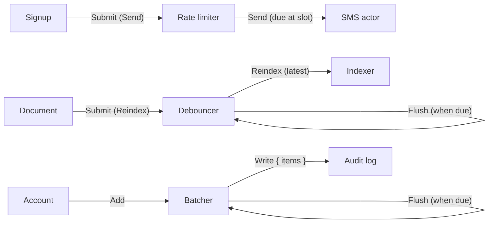
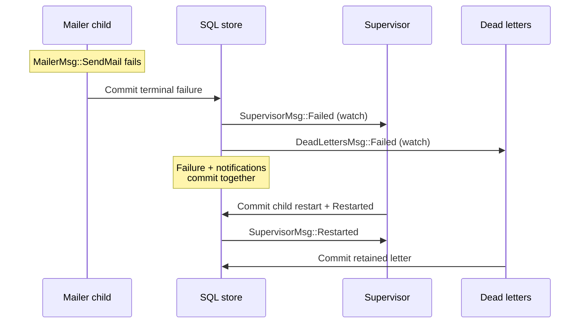
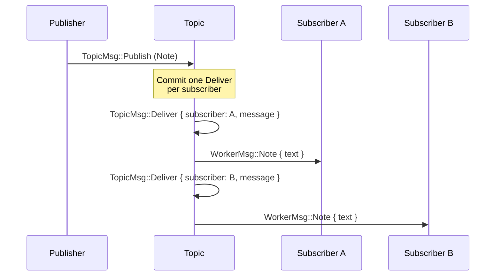
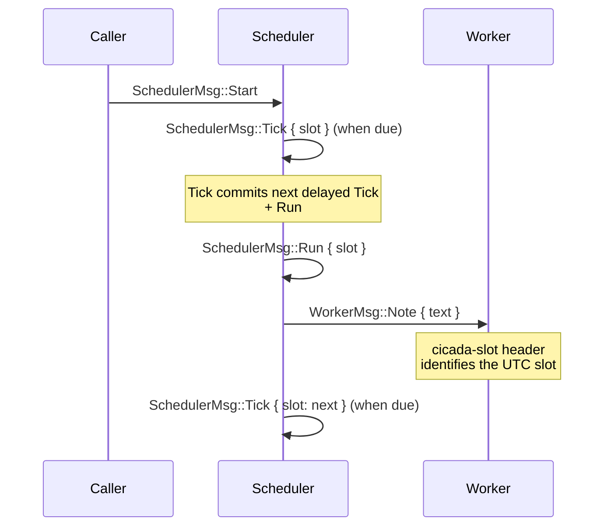
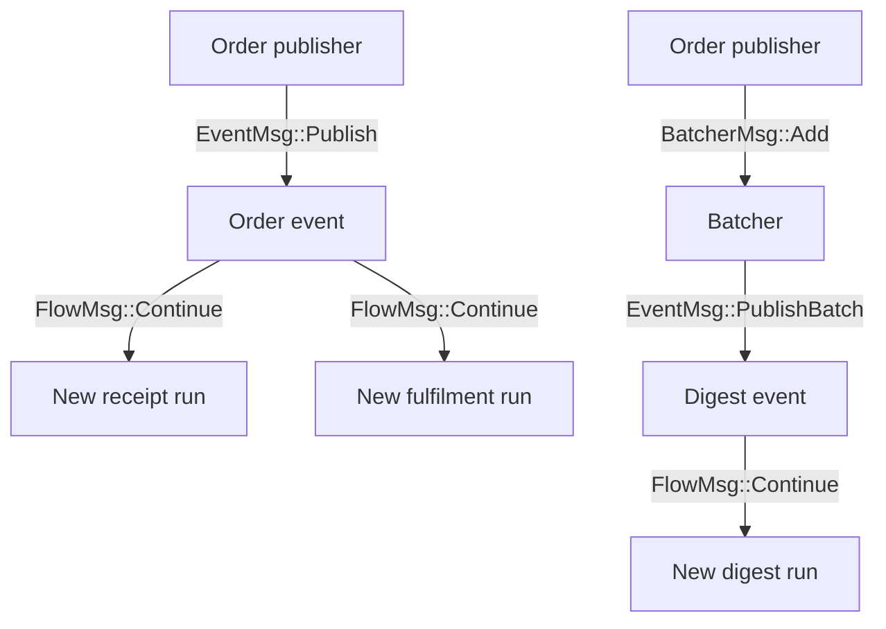

# Ready-made actors: choose a pattern

Host these types from `cicada-actors`, create their instances, then send their public messages.
They use ordinary actor guarantees, watches and control effects from the [core](core.md).

| Need | Actor / type | Complete example |
| --- | --- | --- |
| Restart a child at fault | `SupervisorActor` / `cicada.supervisor` | [supervision](../../examples/src/supervision.rs) |
| Keep and redrive failed messages | `DeadLettersActor` / `cicada.dead-letters` | [supervision](../../examples/src/supervision.rs) |
| Send to existing subscribers | `TopicActor` / `cicada.topic` | [topic tests](../../crates/cicada-actors/tests/) |
| Send at recurring UTC slots | `SchedulerActor` / `cicada.scheduler` | [cron](../../examples/src/cron.rs) |
| Space deliveries at a shared rate | `RateLimiterActor` / `cicada.rate-limiter` | [rate_limit](../../examples/src/rate_limit.rs) |
| Keep the latest value of a burst | `DebouncerActor` / `cicada.debouncer` | [debounce](../../examples/src/debounce.rs) |
| Collect items into one delivery | `BatcherActor` / `cicada.batcher` | [batching](../../examples/src/batching.rs) |
| Run a durable multi-step job | `FlowActor<F>` / host-chosen name | [flow_onboarding](../../examples/src/flow_onboarding.rs) |
| Start flows from a publication | `EventActor` / `cicada.event` | [flow_events](../../examples/src/flow_events.rs) |

## Shared conventions

Use named refs such as `Scheduler::named("nightly")`; dead letters use `_` by convention.
Creating an existing instance leaves its settings and progress untouched. Pause/resume/delete use the core controls.
A delete drops stored work; already forwarded messages stay in their targets’ mailboxes.

`StoredMessage` holds a type name and JSON payload, without an address. Build it with
`StoredMessage::for_ref(&target, message)` for compile-time message-family checking.
[Contract references](../reference/contracts/) contain the exact state and message formats.

Forwarded deliveries get new ids and the forwarding actor as sender. Put reply addresses in payloads.
A submission’s retry policy governs the forwarding turn; the target’s policy is a separate setting.
Target retries do not pass through a limiter, debouncer or batcher again.

**Due time is a lower bound.** Pauses, queueing, outages and slow commits can make delivery late.
Each turn rewrites the state it changes: keep stored values small or store references to external data.

## Message processing

Choose what should reach the target: accepted messages at reserved due times, the latest value after quiet, or a list.
These are three alternatives, not stages of one pipeline.



Labels are the message variants from [rate_limit.rs](../../examples/src/rate_limit.rs),
[debounce.rs](../../examples/src/debounce.rs) and [batching.rs](../../examples/src/batching.rs):
`RateLimiterMsg::Submit` wraps `SmsMsg::Send`; `DebouncerMsg::Submit` wraps `IndexerMsg::Reindex`;
`BatcherMsg::Add` becomes `AuditLogMsg::Write`. A full batch sends during Add without waiting for Flush.
Due times do not bound execution time; a paused or busy target can run later.

## Supervisor

Use a supervisor only when a child can restart from its configured initial state.
**A restart deletes the old state, descendants and mailbox**; purged messages do not become dead letters.
Do not supervise dead letters or a topic whose subscriptions you must keep.



The two watchers act independently. Restarting does not replay the failed message; an operator redrives its letter.
The diagram assumes a handler fault below the restart limit and both watches already configured.

Build `SupervisorState::new().child(Child::new(&ref, &state)?.start(message)?)`, create the supervisor, then send `Start`.
Each child starts independently in its own `StartChild` turn: create as a child, watch, send its start message.
An actor with another parent or no parent cannot be adopted.

| Child failure cause | Response |
| --- | --- |
| `handler`, `timeout` | Restart that child |
| `state` | Give up without deleting its state; escalate permanently |
| `refused`, `message`, `commit`, `node`, `claim-limit` | Leave it running |

A restart suppresses further failures of the same incident until `Restarted` is handled.
The default limit is 3 restarts in 60 seconds; `restart_limit` changes it. Exceeding it fails a supervisor message
as a handler failure, allowing a parent supervisor to restart its tree. A child that cannot start/read fails a
supervisor message permanently instead. Start attempts use 7 attempts with waits doubling from 1 s (63 s total waits).

Send `Start` again to recover a child that was given up or an interrupted restart. A child that stops/is deleted is
forgotten until a later restart of its supervisor. Only real store notifications drive failure handling; internal
messages count only when self-sent. Host the supervisor with its child types to validate entries before creation.
See [the implementation](../../crates/cicada-actors/src/supervisor.rs) for incident and restart details.

## Dead letters

Create the actor and set its watch explicitly. This is the complete setup for a handler-free example host:

<!-- doctest
@@2
# async fn example(store: cicada::Store) -> Result<(), Box<dyn std::error::Error>> {
@@6
# Ok(()) }
-->
```rust,no_run
use cicada::{ActorRef, ActorSystem, WatchTarget};
use cicada_actors::{DeadLetters, DeadLettersActor, DeadLettersState};

let system = ActorSystem::builder(store).host(DeadLettersActor::with_capacity(1_000)?).build();
system.start().await?;
let letters = DeadLetters::default();
system.create(&letters, &DeadLettersState::default()).await?;
system.watch(&WatchTarget::Every, &letters.address()?).await?;
```

Only store `Failed` notifications create letters. Capacity defaults to 1000, with the oldest dropped first.
Letters keep the message, error, cause, attempts, recorded time and notification sequence.

| Message | Result |
| --- | --- |
| `Redrive { message_id }` (`messageId` on the wire) | Send again with a new id, keeping payload/correlation; record `redrivenAs` |
| `Discard { message_id }` | Forget the letter |

A successful redrive happens once per letter. It does not restore the original sender, retry policy or headers.
An invalid message/type or unreadable payload records `redriveError`; a missing target rejects the commit and leaves
the letter unchanged. A redriven failure becomes a new letter.

Payloads up to 61 levels deep stay in `payload`; deeper accepted payloads use compact JSON in `payloadJson`.
Exactly one field is present. In Rust, `LetterPayload::value()` decodes it on demand with exact numeric rounding.
Redrive applies current send checks; retained text does not make invalid/deep data sendable.
Legacy deep letters need conversion or discard: [upgrade procedure](../how-to/upgrading.md).

## Topic



Here the published message is `WorkerMsg::Note`, as in [the topic tests](../../crates/cicada-actors/tests/topic.rs).
`Publish` and `Deliver` wrap that message; subscribers receive `Note`, not `Deliver`.
Each Deliver is a separate topic turn; neither subscriber is created by the topic.

Create `TopicState::default()`, send `Subscribe { subscriber }`, then `TopicMsg::publish(message)`.
`Publish` creates one self-sent `Deliver` per subscriber, so one broken subscriber does not block the others.
Deliveries carry the publication’s correlation id. Per-subscriber publication order holds unless a delivery is retried.

A missing instance rejects its delivery and the topic drops that subscriber after the failure notification.
An unregistered type or unsupported message permanently refuses delivery but keeps the subscription: unsubscribe it
explicitly. The topic watches itself; forged notifications and non-self-sent deliveries do nothing.
One turn per subscriber per publication makes large fan-outs expensive.
[Source](../../crates/cicada-actors/src/topic.rs) and [wire contract](../reference/contracts/cicada.topic.json).

## Scheduler

Build `SchedulerState::new(schedule, &target, message)`, create the actor, then send `SchedulerMsg::Start`.
A slot takes two turns: `Tick` arms the next tick and queues `Run`; `Run` forwards the currently configured message.

| Message | Use |
| --- | --- |
| `Start` | Start or repair the tick chain; safe to repeat |
| `Run` | Deliver now, even before Start, without moving the tick |
| `Update` | Replace supplied schedule/target/message/retry fields; a changed schedule rearms the tick |



Here the configured target message is `WorkerMsg::Note`, as in [the scheduler tests](../../crates/cicada-actors/tests/scheduler.rs).
Set `state.retry` for failures at the target. Scheduled deliveries carry `cicada-slot` in UTC to the second;
a manual `Run` has no slot. Correlation ids are not forwarded. Internal ticks must be self-sent and armed.

A late tick delivers once, then skips missed slots. A failed Run does not stop future ticks; pause/delete an orphaned
schedule to stop repeated failures. Cancelling/purging the armed tick can stall the chain; send Start to repair it.
A retry/redrive of the old tick does not repair it. Never target the scheduler’s own Run: it creates an endless chain.
[Source](../../crates/cicada-actors/src/scheduler.rs).

### Schedule

`Schedule::every(seconds)` aligns intervals to the Unix epoch. `Schedule::daily(hour, minute)` uses UTC.
`next(time)` returns the first slot strictly after the given time. There are no cron expressions or time zones.

<!-- doctest
@@5
# Ok::<(), Box<dyn std::error::Error>>(())
-->
```rust
use cicada::time::Timestamp;
use cicada_actors::Schedule;

let now: Timestamp = "2026-10-02T10:15:30Z".parse()?;
assert_eq!(Schedule::every(3600)?.next(now), "2026-10-02T11:00:00Z".parse::<Timestamp>()?);
```

For work inside your own actor’s turn, use the [cron example](../../examples/src/cron.rs).

## Rate limiter

Create `RateLimiterState::new(count, period, burst, max_delay)` and send
`RateLimiterMsg::submit(&target, message, target_retry)`.
It reserves a GCRA slot and forwards atomically. Count/burst/period must be positive; max delay may be zero.
The interval rounds up to microseconds, and idle time restores the burst.

A slot exactly at `maxDelay` is allowed; a later slot is refused permanently. The limit counts from handling time,
excluding mailbox wait/commit. A failed forward reserves nothing; cancelling a forwarded message returns no capacity.
Forwarded messages keep the submission’s correlation id but not its headers or retention.

**This shapes due times, not external API calls.** A paused or slow target can run several overdue deliveries close
together. Enforce strict external quotas at the call site. Replace the actor to change settings; existing forwards
keep their slots. [Example](../../examples/src/rate_limit.rs).

## Debouncer

Create `DebouncerState::new(quiet, max_wait)` with `0 < quiet <= maxWait`, then submit through
`DebouncerMsg::submit(&target, message, target_retry)`.
The latest target, message, retry and correlation id replace the previous submission together.
It keeps the trailing value only and checks the target at flush time.

Each submission rearms a timer at `min(now + quiet, firstAt + maxWait)`.
Public `Flush` sends the kept value, cancels the timer and clears the burst in one commit; an empty flush does nothing.
Headers/retention are not copied. A failed flush leaves everything intact; send Flush to recover a lost timer, or
submit a new value to replace the old one. A retried old Flush can flush a newer burst early.
Delete/recreate to change settings. [Example](../../examples/src/debounce.rs).

## Batcher

Create `BatcherState::new(&target, message_type, max_items, max_wait)`; `maxItems` is 1–1000 and max wait positive.
Send `BatcherMsg::add(item)` for each item. The target receives `{ "items": [...] }` in handling order.
Set the state’s `retry` for failures at the target. Item headers/correlation ids are not retained.

The first item arms a Flush timer. Filling the batch, an Add at/after the deadline, or a public Flush sends it and
clears it atomically. A stored batch therefore has fewer than `maxItems` items. A failed flush keeps the batch.
If the final Add cannot send, **that new item is not kept**; recover its failed message separately.

A cancelled/purged/failed timer can leave items stranded. Send Flush to recover; an Add before the old deadline does
not rearm it. A retried old Flush can send a newer batch early. Count limits do not bound bytes; keep items small.
Delete/recreate to change settings. [Example](../../examples/src/batching.rs).

## Flows

Use a `Flow` for a job whose durable progress is an ordered sequence of results.
Host it with `FlowActor::new(flow)` under the type name chosen by the flow.
Create a `FlowRun<F>` with `FlowState::new(input)`, then send `FlowMsg::Continue`.

The central part of [flow_onboarding.rs](../../examples/src/flow_onboarding.rs) is ordinary async code:

<!-- doctest
# use cicada::HandlerResult;
# use cicada_actors::Step;
# use std::time::Duration;
# use cicada_examples::steps::OnboardingServices;
# async fn run<S: OnboardingServices>(step: &mut Step, services: &S, email: &str) -> HandlerResult {
@@7
# Ok(()) }
-->
```rust
let account_id: String = step.run("create-account", |key| async move {
    Ok(services.create_account(email, &key).await?)
}).await?;
step.run("send-welcome", |key| async move {
    Ok(services.send_welcome(email, &key).await?)
}).await?;
step.sleep("cool-off", Duration::from_secs(60)).await?;
```

[The flow replay diagram](patterns.md#durable-flows) shows the commit boundaries.

The code runs from the top on each execution. Saved results replay without rerunning their closures; only one new
step, sleep, send, request or wait runs per turn. **Code outside steps must be deterministic and free of external effects.**
Put service calls, clocks and randomness inside steps.

Each closure receives `<run address>/<step id>` as an idempotency key. It can run again after an uncommitted turn;
external effects remain at least once. Never reuse a run key for a different job, even after deletion.

| Concern | Rule |
| --- | --- |
| Errors | `?` propagates the first new step’s suspension/error; catching it cannot continue the turn |
| Business decisions | Save a successful value such as `Result<T, String>` and branch on it |
| Timeouts | Put timeout/select inside the step closure, never around `step.run` |
| Replay compatibility | Keep entry order, ids, kinds and result types stable for in-progress runs |
| Ids and size | Unique ids shared by steps, sleeps, sends, requests and waits; 1–100 chars of `A-Za-z0-9._~-:`, at most 1000 entries |
| Recovery | Public Continue rearms a run whose armed message was cancelled/purged/exhausted |
| Completion | Done and cancelled runs ignore Continue/Reply and retain results; 0.18.1 cannot produce cancelled runs |
| Send delivery | One enqueue per committed entry; the target's execution is at least once, with no retry policy |
| Waiting | A single wait parks with no Continue; the first eligible reply closes it. No timeout |
| Available in 0.18.1 | Steps, sleeps, sends, requests and single reply waits; joins, deadlines and cancellation remain refused |

Only the armed Continue executes the flow; a public poke first replaces/arms it. Default retry is 7 attempts with
waits doubling from 1 s. A replay mismatch is permanently refused. A journal supplied at creation is trusted progress.
Input schema changes affect the contract; step-code changes can break replay **without changing the contract**.
Drain old runs or use a new flow type. The [0.18.0 upgrade](../how-to/upgrading.md#upgrade-flows-to-0180) changes every
flow contract. See [the flow source](../../crates/cicada-actors/src/flow.rs) for the journal API.

### Durable sleep

`step.sleep(id, duration)` saves a store-time deadline and schedules Continue without retaining a running handler.
Replay uses the saved time, even if the code’s duration changes. Early pokes/deliver-now cannot pass the sleep;
late wakes proceed immediately. Zero sleep still creates a commit boundary.

A lost timer is recovered with public Continue; deletion removes the run and timer. Deploy sleep-capable code to every
host before starting sleeping runs. Sleep ids share the step namespace/1000-entry limit; durations are bounded by
`MAX_DELAY` and year 9999. Timer continuations start linked traces with [OpenTelemetry](core.md#opentelemetry).

### Sending to actors

`step.send(id, to, message)` commits an optional target create, one message, its journal entry and the next Continue
together. Use `&actor` for an existing target, `Target::create(&actor, &state)` for an independent actor, or
`Target::child(&actor, &state)` for a child removed when the run is deleted. Existing actors keep their state.

This sends a report using the types from [sync.rs](../../examples/src/sync.rs):

<!-- doctest
# use cicada::HandlerResult;
# use cicada_actors::{Step, Target};
# use cicada_examples::sync::{Reports, ReportsMsg, ReportsState};
# async fn report(step: &mut Step) -> HandlerResult {
@@6
# Ok(()) }
-->
```rust
let reports = Reports { tenant: "acme".into() };
step.send(
    "report",
    Target::create(&reports, &ReportsState::default()),
    ReportsMsg::SyncFinished { imported: 25 },
).await?;
```

The entry saves the destination, generated message id and create kind, not the payload or initial state. Replay
matches only entry id and kind; it converts/serializes none of the proposed arguments, even if the target changed.
Argument construction still runs, so keep it deterministic and free of effects.

Enqueueing is not target success. The message is due now, uses the executing Continue's correlation id and has **no
retry policy**. Target failure leaves flow progress intact; design business-failure reporting and recovery explicitly.

| Problem | Outcome |
| --- | --- |
| Self-target, conversion/encoding error, or a caught conversion panic | Permanently refused |
| Unregistered type, unsupported message, or initial state that is null, contains NUL or exceeds depth limits—even for an existing target | Permanently refused by raw-operation checks |
| Registry read fails | Cause `node`; retried by the flow's policy |
| Missing target, or child create collides with an actor having another parent or none | Commit rejected, cause `commit`; fix the target and send a public Continue |

A failed turn commits no create, message or entry. After a rejected commit, public Continue attempts the send afresh
with a new message id. [Flow tests](../../crates/cicada-actors/tests/flow.rs) cover atomicity, replay and recovery.

### Requests and reply waits

`step.request(id, to, build)` sends work carrying a typed `ReplyTo<T>` route; `step.wait(id, &request)` returns its
reply as `T`. Targets use the same existing/create/child choices as `step.send`. From
[flow_approval.rs](../../examples/src/flow_approval.rs):

<!-- doctest
# use cicada::HandlerResult;
# use cicada_actors::{Step, Target};
# use cicada_examples::flow_approval::{Approvals, ApprovalsMsg, ApprovalsState, Decision, PurchaseInput};
# async fn ask(step: &mut Step, input: PurchaseInput) -> HandlerResult {
# let approvals = Approvals { team: input.team.clone() };
# let empty = ApprovalsState::default();
@@3
# let _: Decision = decision;
# Ok(()) }
-->
```rust
let ask = |reply| ApprovalsMsg::Ask { item: input.item.clone(), cents: input.cents, reply };
let request = step.request("ask-approval", Target::create(&approvals, &empty), ask).await?;
let decision = step.wait("decision", &request).await?;
```

The target stores the route until it can reply from one of its own turns:

<!-- doctest
# use cicada::{HandlerResult, Turn};
# use cicada_examples::flow_approval::{ApprovalsActor, Decision, Pending};
# async fn decide(turn: &mut Turn<ApprovalsActor>, decided: Pending, approved: bool, by: String) -> HandlerResult {
@@1
# Ok(()) }
-->
```rust
decided.reply.send(turn, &Decision { approved, by }).await?;
```

The route is `{run, request}`: run address and request message id, with the same wire form for every `T`.
The request/create/entry/Continue commit together; replay returns the saved request without calling its builder.
The reply commits with the target's turn, is due now, carries that turn's correlation id and has no retry policy.
`reply.send` rejects encoding errors, NUL and values deeper than 61 levels with `TurnError::Invalid`.

A wait saves an open entry and **parks** with `armed: null`: no handler stays open and nothing polls.
The reply turn runs no flow code; it saves the value, closes the wait and arms Continue with the reply's correlation id
atomically. That Continue
replays the committed outcome and returns the value. An early reply is kept; creating its wait still commits the
outcome before returning it on the next execution. See [the message diagram](patterns.md#flow-requests-and-replies).

Only the **first eligible reply from the saved target address** counts. Unknown, duplicate, closed or wrong-sender
replies write nothing. Direct HTTP sends have no sender; delegates, children and dead-letter redrives have their own
addresses. Delegates must return results through the target. Trusted workers executing the target's leased turn send
as that target. This checks actor addresses, not human identity; control who can make the target reply.

| Situation | Recovery or limit |
| --- | --- |
| Target fails, disappears or never replies | No timeout: the run stays parked. Report business failure as reply data, such as `Result<T, String>` |
| Public Continue while parked | Replays and parks again without another entry or request |
| Saved reply does not decode as `T` | Permanently fails execution; fix code and poke with Continue. The saved outcome stays |
| Run deleted before target replies | The target's whole commit is rejected |
| Run paused / continuation lost after closure | Resume to handle replies / send public Continue to replay the saved reply |

Upgrade every host and worker before enabling requests; [0.18.1 rollout](../how-to/upgrading.md#enable-flow-replies-in-0181)
explains why equal contract hashes do not prove support.

## Event

Create an `Event` with `EventState`, subscribe flow type names, then send `EventMsg::publish(input)`.
Each publication creates and starts one independent run per subscribed type **in one commit**.
`publish_batch(items)` supplies input `{ "items": [...] }`, so a batcher targeting PublishBatch feeds an event directly.
[flow_events.rs](../../examples/src/flow_events.rs) shows the full producer and host setup.



This is [flow_events.rs](../../examples/src/flow_events.rs): a topic delivers to existing actors; an event creates
independent flow runs. Each event commits its run creates and Continue messages together.
A failure after creation belongs to that run, not to the successful publication.

The run key is the publication’s message id, percent-encoded once. Do not reuse ids across jobs/events or manually
create runs whose keys could collide. `.` and `..` cannot key subscribed runs. Up to 100 unique flow types can subscribe.

An unknown/invalid subscribed target can fail the entire publication: remove stale subscriptions, then retry.
Registration alone cannot identify a flow; subscribe only flow types. On a non-hosting node, bad input may instead
create a run that fails its first message as `state`. Watch both events and flow types to see the two failure paths.

**Recover a started run with Continue, not another publication.** Operator retry/redrive gets a new publication id,
and therefore new runs. Core deduplication only lasts for the retention window; existing runs retain their first input.
Unsubscribe stops future runs; deleting an event does not delete its independent runs. No publication history is kept.

## Payload depth limits

Wrapping values consumes the core’s 64-level depth budget. Constructors/sends and state writes enforce it.

| Container | Maximum nested payload/input depth |
| --- | --- |
| Supervisor child state / start payload | 61 / 60 |
| Dead letter | 61 as a value; deeper payloads use JSON text |
| Topic, scheduler, rate-limiter payload | 62 |
| Debouncer kept payload | 61 (a 62-level submission can enqueue but fails when stored) |
| Batcher item | 62 |
| Flow input / step result | 63 / 61 |
| Event Publish input / PublishBatch item | 63 / 61 |

A batcher can accept an item the event cannot place in flow state; the publication then fails and starts no runs.
Legacy deep values require the [upgrade procedure](../how-to/upgrading.md); retaining a payload does not relax send
or state limits. Exact wire shapes remain in [contract references](../reference/contracts/).
