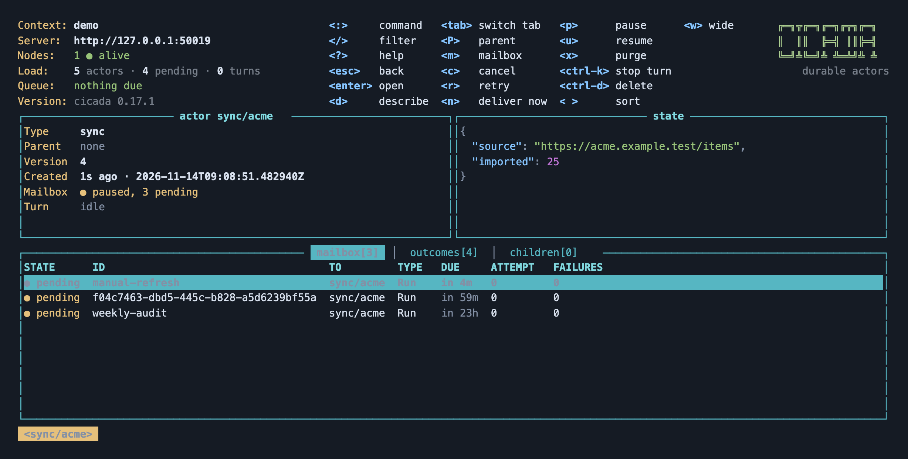

# App: run and operate a binary

Use `cicada-app` when you want actor hosting, HTTP and operator commands in one binary.
Enable `sqlite` or `postgres` for a store and `tui` for the terminal UI; none is enabled by default.

## Run it as a binary

Host your actor and call `run()`. This example uses the actor from [sync.rs](../../examples/src/sync.rs);
your application hosts its own actor from the [core tutorial](core.md#define-an-actor-type).

```rust,no_run
use cicada_app::App;
use cicada_examples::sync::ReportsActor;

fn main() -> std::process::ExitCode {
    App::new().host(ReportsActor).run()
}
```

| Command | Behavior |
| --- | --- |
| `myapp serve --store actors.db` | Run actors and the HTTP API at `127.0.0.1:8080` |
| `myapp serve --store actors.db --types none` | Serve the API without running actors |
| `myapp worker --store actors.db --types reports` | Run selected actors; serve no HTTP |
| `myapp worker --server https://actors.internal` | Run through the HTTP API, with no database access |
| `myapp get actors --server http://127.0.0.1:8080` | Run an operator command against a server |

`--types` accepts `all` (default), comma-separated type names, or `none` for serve only.
A binary without hosted types, including the standalone `cicada`, has neither serve nor worker.

**Authentication.** App supplies none. Before binding beyond loopback, use `App::http` to wrap the API in your
middleware. Apply the layer after merging routes it must protect. `/ready` is public outside that router;
a host route named `/ready` cannot replace it. See [HTTP composition](http.md#run-it-in-an-axum-service) and the
[sample’s middleware](../../sample-service/src/lib.rs). `serve --token` is rejected; a client token does not protect a server.

**Lifecycle.** SIGTERM/SIGINT stops claims, drains turns within the grace period, then cancels them. Serve keeps HTTP
answering during the node stop, with `/ready` returning 503; afterward it drains HTTP for up to 5 s and closes the
store. Worker serves no `/ready`. See [deployment](../operations.md#deploying) for platform stop timeouts.

**Host hooks.** `on_start` runs after the local node starts and before serve listens; use it to create required actors.
Errors stop the node. `observe`, `node_config` and `version` configure the host. Use `run_async` from an async main;
`run_with` supplies arguments, environment, output and stop handling for tests. Avoid expensive setup for operator
commands by checking `cicada_app::node_command` before building dependencies.

### Settings

Flags override non-blank environment variables. For node settings, variables override the host’s `NodeConfig`, then
library defaults. Durations accept `250ms`, `5s`, `7d`, or ISO-8601 (`PT5S`).

| Flag | Variable | Default | Meaning |
| --- | --- | --- | --- |
| `--store` | `CICADA_STORE` | required, but for a worker over HTTP | `postgres://…` or `postgresql://…` (PostgreSQL), `sqlite:FILE`, or the path of a SQLite file. Another value with `://`, or one that starts with `postgres:`, is refused and never printed, as it may hold a password |
| `--store-schema` | `CICADA_STORE_SCHEMA` | `public` | the schema, on PostgreSQL |
| `--store-pool-size` | `CICADA_STORE_POOL_SIZE` | the larger of 20 and the concurrency plus 4 | the connections of this node, on PostgreSQL |
| `--retention` | `CICADA_RETENTION` | 7 days | how long outcomes are kept, also the window in which a message id is known (S10); set one value on every node |
| `--listen` | `CICADA_LISTEN` | `127.0.0.1:8080` | the address `serve` listens on |
| `--types` | `CICADA_TYPES` | `all` | the types of the node: `all`, type names with commas, or (`serve` only) `none`; `all` and `none` are keywords only as the whole value |

| Flag | Variable | `NodeConfig` field |
| --- | --- | --- |
| `--node-id` | `CICADA_NODE_ID` | `node_id` |
| `--concurrency` | `CICADA_CONCURRENCY` | `concurrency` |
| `--lease-ttl` | `CICADA_LEASE_TTL` | `lease_ttl` |
| `--heartbeat-interval` | `CICADA_HEARTBEAT_INTERVAL` | `heartbeat_interval` |
| `--poll-interval` | `CICADA_POLL_INTERVAL` | `poll_interval` |
| `--shutdown-grace-period` | `CICADA_SHUTDOWN_GRACE_PERIOD` | `shutdown_grace_period` |
| `--max-turn` | `CICADA_MAX_TURN` | `default_max_turn` |
| `--max-lost-claims` | `CICADA_MAX_LOST_CLAIMS` | `max_lost_claims`: a number, or `off` |

See [configuration defaults](core.md#configuration) and [generated help](../reference/cli.md) for exact options.
On an unavailable PostgreSQL database, startup retries a second after each attempt, starting no new attempt after
one minute. Individual attempts can make the total longer. Logs use `tracing` on stdout, with `RUST_LOG`
(default `info,sqlx=warn`).

Exit codes: **0** success or requested stop, **2** invalid usage/environment, **1** operational/startup failure.

### A worker over HTTP

Use the same App without an `on_start` hook:

```sh
myapp worker --server https://actors.internal --token "$TOKEN"
myapp worker --context prod --types reports
```

| Selection | Result |
| --- | --- |
| Explicit `--store` | Local store |
| Explicit `--server` or `--context` | HTTP |
| Both explicit modes | Usage error |
| No explicit mode, non-blank `CICADA_STORE` | Store, even with operator server/context variables |
| Otherwise `CICADA_SERVER` or `CICADA_CONTEXT` | HTTP |
| Only token or config’s current context | No mode selected; usage error |

A worker on the store reads neither the operator config nor `CICADA_TOKEN`; `--token` is invalid there.
For HTTP mode, resolve server/context/token as for [operator commands](#command-line-and-terminal-ui).

The server owns TTL, heartbeat, claim limit, retention and store configuration: their flags are rejected and their
variables ignored. Worker id, concurrency, poll interval, maximum turn and grace period still apply.
`on_start` is refused before any request; bootstrap through serve or a local-store worker instead.

The HTTP client disables redirects and retries of its own. Requests have a 30 s total timeout, with a 10 s turn-call
timeout. Startup probes `GET /types` while unavailable, with no new probe after a minute, then registers contracts
once. A refusal or conflict fails startup. The worker needs access to type reads/registration and every lease route.

SIGTERM/SIGINT drains the worker and leaves the source running. A fatal lease error stops it with exit 1.
It has no node row or readiness endpoint. The [HTTP guide](http.md#run-a-worker-over-http) covers uncertainty and limits;
[remote_worker.rs](../../examples/src/remote_worker.rs) shows library-level construction.

## Command line and terminal UI

Install the operator from the checkout:

```sh
cargo install --path crates/cicada-app --features tui
cicada config set-context local --server http://127.0.0.1:8080
cicada get actors
cicada tui
```



The actor view keeps state, mailbox, outcomes and children together. This capture uses the sample service on
an isolated SQLite store; [capture instructions](../assets/README.md) explain how to refresh it.

All operator commands call HTTP. Omit `--features tui` to build without terminal libraries.
Use [generated CLI help](../reference/cli.md) for flags and command details.

| Task | Command |
| --- | --- |
| Inspect | `get actors`, `get actor ADDR`, `get mailbox ADDR`, `get message ID` |
| Inspect in full | `describe actor ADDR` (YAML); add `-o json` for JSON |
| Create/send | `create actor ADDR --state JSON`; `send ADDR --type TYPE --payload JSON` |
| Recover | `retry message ID`, `deliver-now ID`, `resume ADDR` |
| Control | `pause ADDR`, `purge ADDR`, `cancel turn ADDR`, `delete actor ADDR` |
| Diagnose | `get outcomes --status failed`, `get turns`, `get nodes`, `stats`, `health` |

A delete includes descendants. Retry creates a new message; purge/cancel/delete have distinct effects:
read [the incident guide](../operations.md#on-call) first. Listings show one page; `--all` traverses every page.
Missing items and API failures exit 1. Usage errors exit 2.

### Server and credentials

Resolve each field independently:

| Field | Precedence |
| --- | --- |
| Server | `--server`, `CICADA_SERVER`, context server |
| Context | `--context`, `CICADA_CONTEXT`, config current context |
| Token | `--token`, `CICADA_TOKEN`, context token |
| Config path | `CICADA_CONFIG`, `$XDG_CONFIG_HOME/cicada/config.toml`, `~/.config/cicada/config.toml` |

Context headers/token still apply when its URL is overridden. A missing file is empty; an unreadable file or unknown
context fails. `config set-context` replaces a context; `config use-context` switches it. Writes replace the file’s
comments, preserve symlinks and set Unix permissions to 0600.

### Terminal keys

| Keys | What |
| --- | --- |
| `:actors`, `:messages`, `:outcomes [status]`, `:turns`, `:watches`, each with an optional prefix; `:nodes`, `:types` | A listing; Tab completes; Enter on a watch opens its watcher |
| `:actor ADDR`, `:mailbox ADDR`, `:message ID`, `:node ID`, `:type NAME` | One item |
| `enter`, `esc`, `q` | Open the selected row; clear the filter or go back; `q` on the first screen and `ctrl-c` quit |
| `j` `k` `↑` `↓`, `g` `G`, `pgup` `pgdn` | Move |
| `/`, `<` `>`, `s`, `w` | Filter rows as you type; sort column; sort order; wide columns |
| `tab` | The next tab of an overview (an actor's mailbox, outcomes and children) |
| `d` | Describe: the item as YAML; `t` switches to JSON, `w` wraps |
| `m`, `a`, `b`, `P` | An actor's mailbox; a message's actor; its cause; an actor's parent |
| `c`, `r`, `n` | Cancel, retry, deliver now a message |
| `p`, `u`, `x` | Pause, resume, purge an actor's mailbox |
| `ctrl-k`, `ctrl-d` | Stop the running turn; delete an actor or remove a type |
| `ctrl-r`, `?` | Refresh now; help |

Actions apply to the selected row, or the displayed item, after confirmation (default No).
The display refreshes every 2 s and the header every 10 s. Sending and bulk actions are CLI only.

## Sample service

The [sample service](../../sample-service/) hosts the worked examples and E2E actors:

```sh
cargo run -p cicada-sample-service -- serve --store actors.db
```

It creates required singletons and the dead-letters watch for hosted types. `GET /` and `/ready` are public.
Set `API_TOKEN` to require a bearer token on the API. Set `OTEL_EXPORTER_OTLP_ENDPOINT` for telemetry; the protocol
must be unset or `http/protobuf`. Use `CICADA_NODE_ID` consistently; a differing `--node-id` fails startup.
The image defaults to `0.0.0.0:8080`, `/data/actors.db`, and a 3 s shutdown grace period.
Legacy unprefixed variables are rejected; see the [0.13.0 upgrade](../how-to/upgrading.md).

## Running it

Continue with [operations](../operations.md) for sizing, deployment and incident diagnosis.
