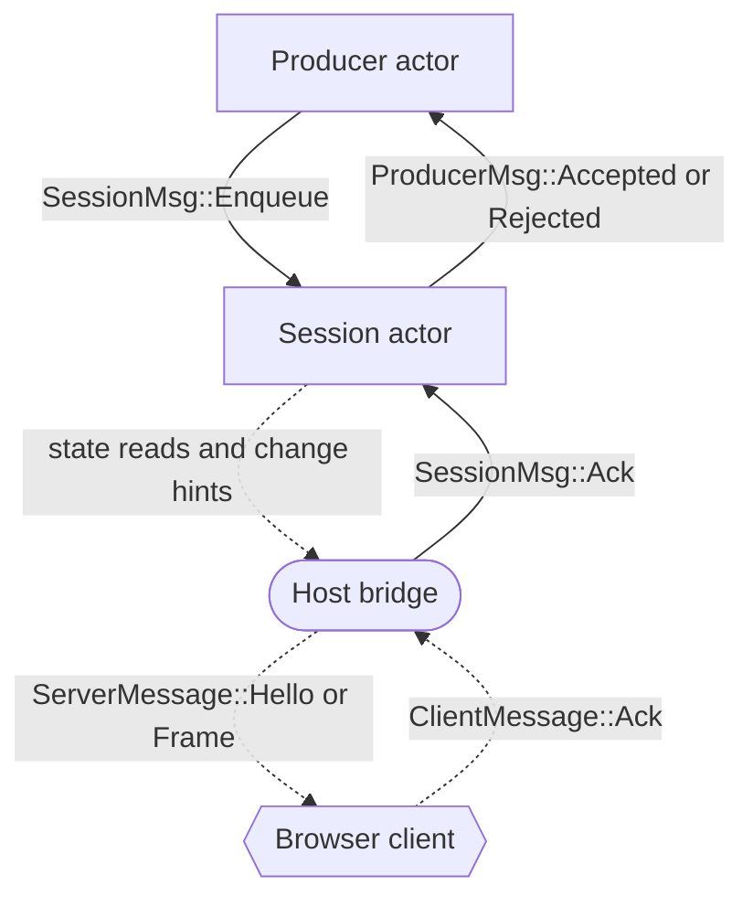
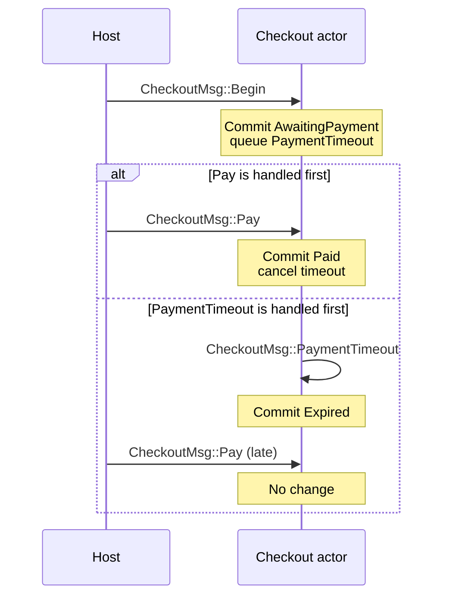
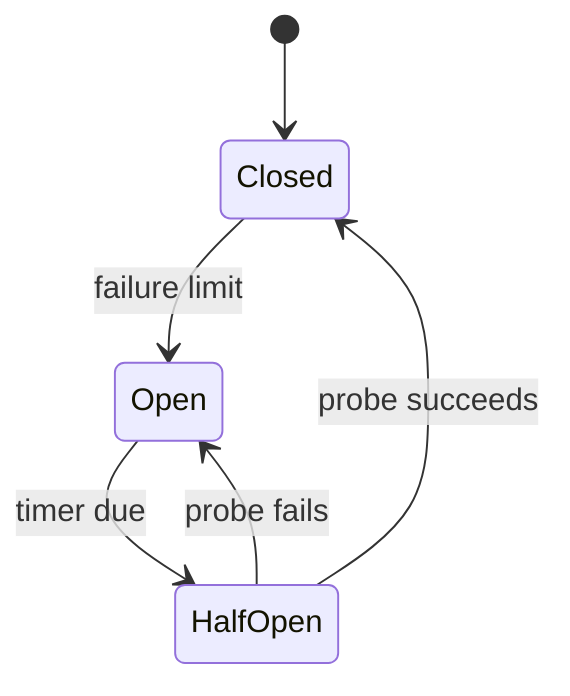
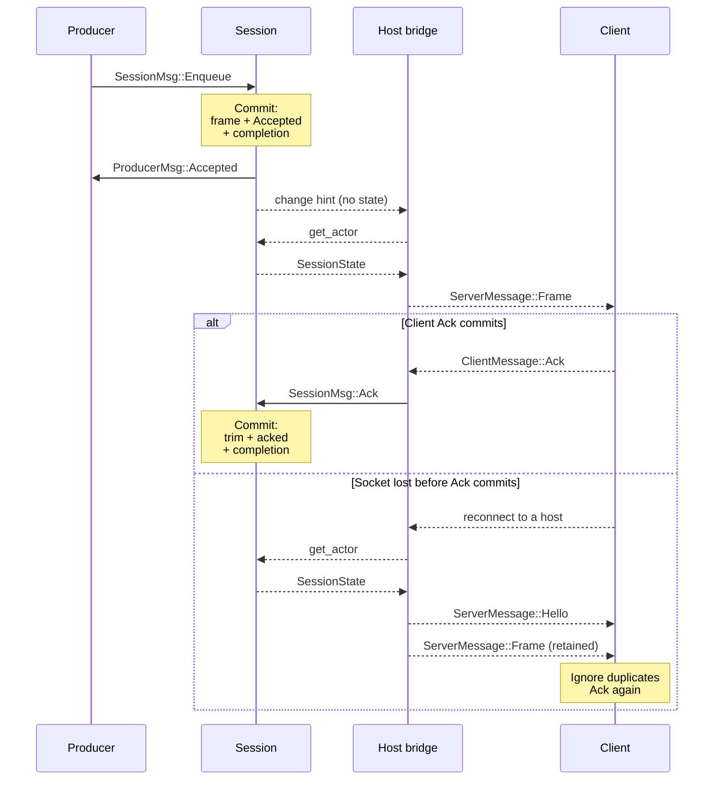
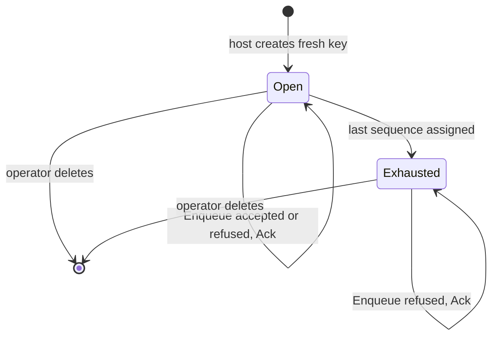

# Design with actors

Decide which actors exist, what each owns and what they say to each other before writing handlers.
Use [Design an actor](core.md#design-an-actor) for the short rules for one type; this guide connects several owners
into a system. The [architecture](../architecture.md) defines Cicada's guarantees.

## From problem to design

Start with a story: a client disconnects after a server sends a line, then reconnects to another host. Who still
owes it that line? Work from that obligation toward identities and messages, rather than turning each class into
an actor. A function, a table with a transaction or a read model may solve the problem more simply. Use actors
where a rule needs an owner over time; a mixed system is normal.

Write a result at each step:

| Step | Ask | Write down |
| --- | --- | --- |
| 1. The promise | What counts as success, refusal, cancellation or unknown? What must never happen? Which effects cannot be undone? Would a design without actors do? | A short contract and hard limits |
| 2. Who and what | Which facts happen, caused by what? What acts independently? Which facts are authoritative, derived or suspected? | A timeline of the domain |
| 3. Who owns each rule | Which data must one decision see together? Can one owner refuse a conflicting command alone? | A map from rule to owner |
| 4. Identity and life | What routes requests to the same actor? Can a key return? Who creates and ends it? What happens to children, pending work and late replies? | Identity rules and a lifecycle sketch |
| 5. Responsibility cards | What does each actor decide, own, only observe and leave to others? What grows? | One card per actor |
| 6. Protocols | Command, event, query or reply? What names the work, conversation, reply address and deadline? What does an acknowledgement prove? | A message table and a state table per actor |
| 7. Coordination and time | What happens on timeout, repeat, reorder, cancellation or dependency failure? Who records progress and picks recovery? | Sequence diagrams with failure branches |
| 8. The outside | Who decides an outside action? What names it across retries? What if it happened but was not recorded? | An effect list and reconciliation plan |
| 9. Check and simplify | Can a short trace break a rule or orphan accepted work? Which actors only forward and could be functions? | Counterexample traces and simplifications |

For the [websocket session](#a-websocket-session), one pass gives these decisions:

1. Keep accepted output until the client acknowledges processing; replay in order after reconnect. Applying a frame
   and saving a browser cursor are separate operations, so this promises no exactly-once client processing.
2. The producer offers a line, the session accepts or refuses it, the host writes it, and the client acknowledges it.
3. The session alone owns sequence assignment, the replay buffer and the durable acknowledgement.
4. The host creates a fresh stream key for one logical client. Deletion ends that life; the key is never reused.
5. The session's responsibility card is below; socket ownership belongs to the host.
6. `Enqueue` gets `Accepted` or `Rejected`; only `Ack` trims output. A socket write proves no processing.
7. Draw disconnect before acknowledgement, repeated acknowledgement, a full buffer and a missing reply destination.
8. Socket writes are outside effects. Reconcile by replaying from the durable acknowledgement and the client's cursor.
9. Keep a simple state-following host, with no socket registry. Test short bad traces before adding coordination.

| Session card | Decision |
| --- | --- |
| Identity and purpose | `ws.sessions/<stream>`: one stream life of one logical client; keep what it has not processed |
| Decides | Accept or refuse a body, assign its sequence, advance the acknowledgement |
| Protects | Contiguous assigned sequences; retain accepted frames until acknowledged, while the session is retained |
| Messages and replies | Receives `SessionMsg::Enqueue`, `SessionMsg::Ack`; sends `ProducerMsg::Accepted` or `ProducerMsg::Rejected` |
| Partners | Producer and host bridge; neither owns the session's state |
| Lifecycle | Host creates; operator deletion ends the stream |
| Bounds | 100 retained frames, 1024 UTF-8 bytes per body, sequences through 2^53 − 1 |
| Outside effects | None in the session handler; the host owns socket I/O |
| Recovery | A failed turn applies no changes; sender policy controls retries. The host/client reconnect and replay |

## Choose actors and identities

An order owns its lines and total; stock for a SKU owns availability. Putting each line in another actor would split
the order's total rule. Reserving stock is instead an agreement between owners. Find actors in independent activities,
lasting business identities and resources that need one authority. Size each to the data its rule needs together.

In Cicada, a type plus a key names an instance. Its turn is the transaction boundary
([G1 and G2](../architecture.md#guarantees)). No turn operation reads or writes another actor's state: ask that owner
for a decision by message. An outside snapshot is useful for a screen, but is not a reservation.

Use stable business keys. A composite key is still one string; [fanout.rs](../../examples/src/fanout.rs) shows the
conversion. If outside work from an earlier life can arrive, give the next life a new key. Delete purges the old
mailbox and fences old turns, but cannot retract their outside calls ([ADR 0024](../adr/0024-control-effects.md)).

Name who creates every actor. Sending does not create it: a turn's send to an absent actor rejects that commit.
Creation and the first send can commit together. [Parent/child ownership](core.md#child-actors) controls cleanup;
[watches](core.md#watches) control who hears failures and removal. Draw these as separate relations.

Keep bounded history, child actors or references rather than every past fact in one state. See
[fan-out](../../examples/src/fanout.rs) and the [registry](../../examples/src/registry.rs). A
[singleton](../../examples/src/singleton.rs) serializes all its work; reserve it for genuinely global, infrequent decisions.



This map uses the websocket example's actual message families. Solid arrows are queued messages; dashed arrows are
state observation and socket I/O, outside a turn's commit. The host reads state explicitly; hints carry no state.

## Design protocols

A cart asks for a price; a quote can be refused or can arrive after the cart has changed. Define the request,
outcomes and late-reply rule before handlers. A command asks for a decision, an event reports a fact, a query asks
for information, and a reply settles a particular request. A refusal is data; a fault is failure.

Request and reply are two messages. Reply to `message().from` using `send_to` and carry the correlation id, as in
[reply](../../examples/src/reply/), or put a typed ref in the request: `reply_to: Order` in
[saga](../../examples/src/saga/), `reply_to: Producer` in the websocket example. Flows provide
[`ReplyTo<T>`](actors.md#requests-and-reply-waits).

Keep three identities distinct: the message id names an operation, the correlation id a conversation, and `attempt`
the claim attempt. A repeated message id is a duplicate only within the [deduplication window](core.md#message-persistence).
G4 applies committed effects once; it does not recognize the same business intent submitted under two new message ids.
Use a business key when that distinction must survive longer.

Say what each acknowledgement proves. A successful send means stored, not business acceptance. The session's
`Accepted { request, seq }` names the `Enqueue` message id and proves that its frame committed. `Rejected { request,
reason }` is an ordinary business reply. Returning `Err` fails a turn; `turn.fail(..)` makes the failure permanent.

Every variant in a message family is public, including timers and replies. Checking `message().from` validates an
actor protocol; it is not authentication. The host must authorize HTTP callers and socket clients.

Write a state table: an exhaustive Rust match covers messages, not every combination of state and message.
For the session:

| State | Message | Result |
| --- | --- | --- |
| Any, with capacity and sequence available | `Enqueue`, body fits | Append frame `assigned + 1`; reply `Accepted` in the same commit |
| Any | `Enqueue`, refused | Reply `Rejected`; session state unchanged |
| Any | `Ack`, same stream, `acked < through <= assigned` | Drop frames `<= through`; set `acked` |
| Any | Other `Ack` | No change |

Distinguish submission validation from application refusal. Cicada refuses NUL in a payload and values deeper than
64 nested arrays/objects at send time: `ActorSystem` returns `OpError::Invalid`, a turn returns `TurnError::Invalid`,
and the receiver gets nothing and sends no reply. The session's 1024-byte application limit instead produces
`Rejected { reason: InvalidBody, .. }`. See [value limits](core.md#how-deep-a-value-can-be).

## Coordinate work and time

An order reserves stock, charges and ships. Its state records what was requested, confirmed or remains unknown;
an earlier reply is local knowledge, not a lock on a partner. Across actors, agreement takes messages over time.
Use a [saga with compensation](../../examples/src/saga/) when finished steps need undoing. Compensation is another
business action and can fail too; intermediate results remain visible.

Use [durable steps](../../examples/src/steps.rs) for independent progress, [flows](actors.md#flows) for process
managers with waits and deadlines, and [fan-out/fan-in](../../examples/src/fanout.rs) for a fixed set of parallel jobs.
Record who owns completion, cancellation and timeout. A timeout means the result is unknown; it does not stop the target.

Time belongs in the protocol. Define expiry, late replies and the race with completion. A
[timer](../../examples/src/timer.rs) keeps the pending message id; a generation number can also reject an obsolete
timeout. [Cron](../../examples/src/cron.rs) and the [scheduler](actors.md#scheduler) handle recurring work.



This is the checked checkout protocol in `timer.rs`: arrows show queued messages, notes their turn commits.
The timeout is never early but may run late. Per actor, due time then enqueue sequence orders delivery; concurrent
senders and rescheduled retries need explicit protocol rules, not assumptions about arrival order.

Bound deferred work in state and refuse beyond the limit. [Flow approval](../../examples/src/flow_approval.rs)
refuses beyond 100 pending requests; the session refuses `BufferFull`. Neither bounds the actor's mailbox.
One-way sends avoid a blocking call cycle, but two actors can still each wait for a message the other never sends.
Give waits deadlines and an owner who resolves them.

## Recover from failure

A payment gateway can be unavailable while an order remains valid. Decide who recovers it and which condition
recovery restores. A declined payment is a reply; an unavailable dependency may fail the turn. Give one layer the
retry budget rather than multiplying retries through the call chain.

A failed Cicada turn applies none of its new state or buffered effects, leaving the last committed state.
The sender chooses [handler retry](core.md#retry); abandoned claims have separate [recovery limits](core.md#claim-limit).
[Watches](core.md#watches) deliver `Failed` and `Stopped` as messages. The
[supervisor](actors.md#supervisor) restarts one child, deliberately resetting its state; [dead letters](actors.md#dead-letters)
keep failed work for inspection and redrive. [supervision.rs](../../examples/src/supervision.rs) connects them.

A group restart can be written with delete and create effects for several actors in one commit. A circuit breaker
can be written as gateway state plus a timer, or as another actor that pauses and resumes the gateway through
[control effects](core.md#control-effects). These are designs built with existing APIs, not ready-made restart-group
or breaker actors:



This breaker sketch needs an application-defined protocol, thresholds and retry owner. Each state transition would
be a committed turn; the outside probe can repeat if its turn does not commit.

## Work with outside systems

An order sends an email and writes an application audit row. Neither action is part of Cicada's turn transaction,
even if that row lives in the same database server. The local atomic step ends at the buffered effects
([G4](../architecture.md#guarantees)); handler code and outside calls can execute again.

Name each outside effect before its first uncertain attempt: use the message id, a flow step's stable key or a
business id. Check how long the destination remembers it. A database upsert keyed by message id can protect the audit
write; an email service needs its own duplicate handling. Putting the call in a flow step retains progress after a
successful commit, but does not make the call itself atomic. Put separate turns between effects that need independent
progress ([steps.rs](../../examples/src/steps.rs)).

Keep planned, unknown and confirmed as meaningful states. If a call succeeded but its result did not commit, ask
the outside system by key before acting again. Persist the intent in an earlier turn when recovery must see it;
a state change in the failed turn did not survive.

A socket, child-process handle or device connection cannot be actor state. Durable state survives turns; memory
held by dependencies on the actor struct belongs to that host process. Choose how the actor meets the handle:

| Form | How it works | Recovery to design |
| --- | --- | --- |
| Turn uses a host-held handle | The actor struct holds a handle table keyed by actor identity; state records desired and observed facts | Empty table after host restart, an outside action without a commit, stale events from an old incarnation |
| Host follows durable state | A task holding the handle subscribes before reading, reconciles state on hints and a timer, acts, and reports back by message | Missed hints, disconnects, repeat actions and acknowledgement loss |

The first form works today when only one node hosts the type: any hosting node may execute its next turn.
Do not assume actor placement or a pin API. The second form works with hosts on several nodes sharing the store;
the [websocket session](#a-websocket-session) demonstrates it. For observation alone, a local task can simply send
readings or `Beat` messages to an actor that runs anywhere.

## Choose a pattern

For a stock reservation, choose one inventory owner and request/reply first. Add a saga only when the order must
coordinate several independently committed decisions. Each extra conversation adds state and recovery work.

| Pattern | Fits when | Cost | Checked example or guide |
| --- | --- | --- | --- |
| Actor per entity | One rule needs one lasting owner | A commit per handled message | [Registry](../../examples/src/registry.rs) |
| Request/reply | One owner needs another's decision | Two messages, correlation and a late-reply rule | [Reply](../../examples/src/reply/) |
| Saga | Several steps must complete or be compensated | Visible intermediate states; compensation can fail | [Saga](../../examples/src/saga/) |
| Durable steps | Effects need independent progress | A turn per step | [Steps](../../examples/src/steps.rs) |
| Flow | A long process waits on partners or deadlines | Journal bounds and replay rules | [Onboarding](../../examples/src/flow_onboarding.rs), [approval](../../examples/src/flow_approval.rs) |
| Timer | A deadline or later attempt | Recognizing an obsolete timeout | [Timer](../../examples/src/timer.rs) |
| Supervision | A child should return to its configured first state | Restart discards its previous state | [Supervision](../../examples/src/supervision.rs) |
| Outside service | A handler calls another system | Stable effect key and reconciliation | [Import](../../examples/src/sync.rs), [steps](../../examples/src/steps.rs) |
| Host follows state | A live handle can be held by any host | Periodic reads and reconnect logic | [Websocket session](../../examples/src/websocket_session.rs) |
| Ready-made actor | A limiter, debouncer, batcher, scheduler or topic fits | Its particular contract and bounds | [Actors](actors.md) |

## Recognize design mistakes

An order works in a happy-path test, then a delayed reply charges a cancelled order. Trace the messages and the
state each one sees, including repeats and old incarnations. Isolation removes shared-state races, not protocol races.

| Mistake | Symptom | Correction |
| --- | --- | --- |
| Split rule | Owners disagree; compensation appears everywhere | Put the rule's data together or design an explicit saga |
| One actor for all traffic | A growing mailbox makes unrelated work wait | Key by the natural unit; keep global singleton work rare |
| Unbounded state | Larger state slows every turn or reaches nesting limits | Bound history and pending work; use children or references; refuse excess |
| Assumed message order | Concurrent senders or retries break the sequence | Carry versions or sequences; handle every arrival in the current state |
| Unclear acknowledgement | Stored is mistaken for done | Name what a reply proves; return the business result |
| Wait cycle | Two actors wait forever | Assign each wait a deadline and a timeout owner |
| Unsafe outside effect | A lost claim causes another charge or email | Stable effect identity, separate progress and reconciliation |

G4 makes one message's committed internal effects happen once. Submitting the same business request twice with new
message ids still creates two operations. Neither G4 nor a successful socket write deduplicates a client-side effect.
Use [TestActors](core.md#testing-with-testactors) and short counterexample traces to check the rules you add.

## A websocket session

[Example 20](../../examples/src/websocket_session.rs) keeps durable output for one logical client, while a host
holds its socket. Independent tabs or devices need independent session keys. The host authenticates the caller,
authorizes that stream and creates `Session { stream }` with `SessionState::default()` under a fresh, never-reused key.
Knowing the key or setting an actor message's sender proves no permission.

The protocol has five steps:

1. A producer sends `SessionMsg::Enqueue { body, reply_to }`. The session appends frame `assigned + 1` and sends
   `ProducerMsg::Accepted { request, seq }` in the same commit as message completion. `request` is the Enqueue's id.
2. A refusal instead sends `ProducerMsg::Rejected { request, reason }`, leaving session state unchanged. Precedence
   is `InvalidBody` (over 1024 UTF-8 bytes), `BufferFull` (100 unacknowledged frames), then `SequenceExhausted`
   (2^53 − 1 assigned). It evicts nothing and requests no retry. NUL is refused at submission, without a reply.
   A missing reply actor rejects the whole commit, so no frame is kept. The demo producer keeps one request in flight
   and records the last answer.
3. The bridge subscribes before reading, sends `ServerMessage::Hello { stream, acked }`, then retained
   `ServerMessage::Frame { stream, seq, body }` values above `acked`. It rereads on an exact-address hint, `Resync`
   or its one-second poll. Its per-socket sent cursor only avoids repeats on that socket; it is not processing evidence.
4. The client applies only the next contiguous frame, saves a cursor per stream, then sends
   `ClientMessage::Ack { stream, through }`. The host forwards `SessionMsg::Ack { stream, through }`.
   Only a same-stream acknowledgement above `acked` and no higher than `assigned` trims the buffer.
5. Reconnect to any host sharing the store. A new `Hello` and the retained frames let the client ignore duplicates
   and acknowledge them again. The session does not expire itself.



Solid arrows are queued actor messages; dashed arrows are hints, host reads and socket I/O. Notes mark atomic
turn commits, not socket delivery. A hint can be missed and a write can repeat; the poll and reconnect reconcile state.



These are stream lifecycle states: assigning sequence 2^53 − 1 exhausts new output, while acknowledgements can
still trim it. A new stream needs a new key. The diagram does not describe the lifetime of a socket.

The [runnable host](../../examples/examples/websocket_session.rs) hosts `SessionActor` and `ProducerActor`, creates
their instances and mounts [the adapter](../../examples/src/websocket_session/adapter.rs). Given such a running
system and a shutdown token, the socket route can be served as follows:

```rust,no_run
use cicada::ActorSystem;
use cicada_examples::websocket_session::adapter;
use tokio_util::sync::CancellationToken;

async fn serve_sessions(system: ActorSystem, shutdown: CancellationToken) -> anyhow::Result<()> {
    // Put the host's authentication and stream authorization before this router.
    let app = adapter::router(system, shutdown.clone());
    let listener = tokio::net::TcpListener::bind("127.0.0.1:0").await?;
    axum::serve(listener, app).with_graceful_shutdown(shutdown.cancelled_owned()).await?;
    Ok(())
}
```

The caller cancels the shutdown token to stop the server; the runnable example does so on
Ctrl-C. The adapter serves `GET /sessions/{stream}/socket`. It authenticates nobody: add host authentication and
stream authorization before the upgrade. Incoming frames/messages are limited to 4 KiB and buffered writes to
16 KiB; each output message is flushed. Binary or malformed input closes with code 1003. Store reads, acknowledgement
sends and socket writes time out after five seconds. A store/feed failure, missing session, I/O error or shutdown
ends both bridge halves; an uncertain ack send closes too, leaving reconnect to reconcile it.

The [minimal browser client](../../examples/examples/websocket_session.html) keeps a stream cursor in local storage.
Its `onmessage` handler uses the connection generation to ignore callbacks from an older socket:

```javascript
socket.onmessage = (event) => {
  if (mine !== generation) return;
  const message = JSON.parse(event.data);
  if (message.stream !== stream) return;
  if (message.type === "Hello") {
    if (message.acked > cursor) {
      generation++;
      socket.close();
      log(`cursor ${cursor} is behind acknowledged ${message.acked}: recover, or start a new session`);
      return;
    }
    ack();
  } else if (message.type === "Frame") {
    if (message.seq <= cursor) ack();
    else if (message.seq !== cursor + 1) reconnect();
    else {
      log(`${message.seq}: ${message.body}`);
      cursor = message.seq;
      localStorage.setItem(cursorKey, String(cursor));
      ack();
    }
  }
};
```

The linked file supplies `connect`, `ack`, `reconnect` and the variables. To try the complete demo:

```sh
cargo run -p cicada-examples --example websocket_session
```

Open its printed browser URL: lines appear in order. Reload to reconnect. The Rust adapter has a real websocket
handshake test; the HTML client has been inspected, not checked in a browser.

Keep the application limits explicit:

- Applying a frame and storing its cursor are separate. A crash between them can apply the frame again: there is
  no exactly-once client processing promise. If the cursor is lost behind `Hello.acked`, acknowledged frames are
  gone; recover through another application mechanism or start a new stream.
- The host keeps no socket registry and does not fence old sockets. Old sockets can still deliver bytes. For the
  same logical client, repeated or stale acknowledgements are harmless; connection generations ignore old callbacks.
- Replay needs a live store, running session handlers, a reconnecting client and retained work. Deletion removes
  the retained output; purge can remove pending work. Neither the 100-frame bound nor this protocol bounds the mailbox
  or the number of sessions.
- An uncertain send must repeat its message id within the deduplication window (seven days by default). There is
  no permanent business deduplication, and a stored send still needs the session's application reply.
- Hints are best effort: memory/SQLite cover one `Store` and its clones; PostgreSQL covers upgraded nodes on one
  schema. The second-system test shares a memory store. The periodic read covers changes outside hint coverage.

The [26 example tests](../../examples/tests/websocket_session.rs) cover acceptance/refusal, atomic rollback, uncertain
sends, acknowledgement validation, reconnects, missed hints, timeouts, shutdown and the websocket route. These are
checks of this example's application convention, not new Cicada delivery guarantees.
