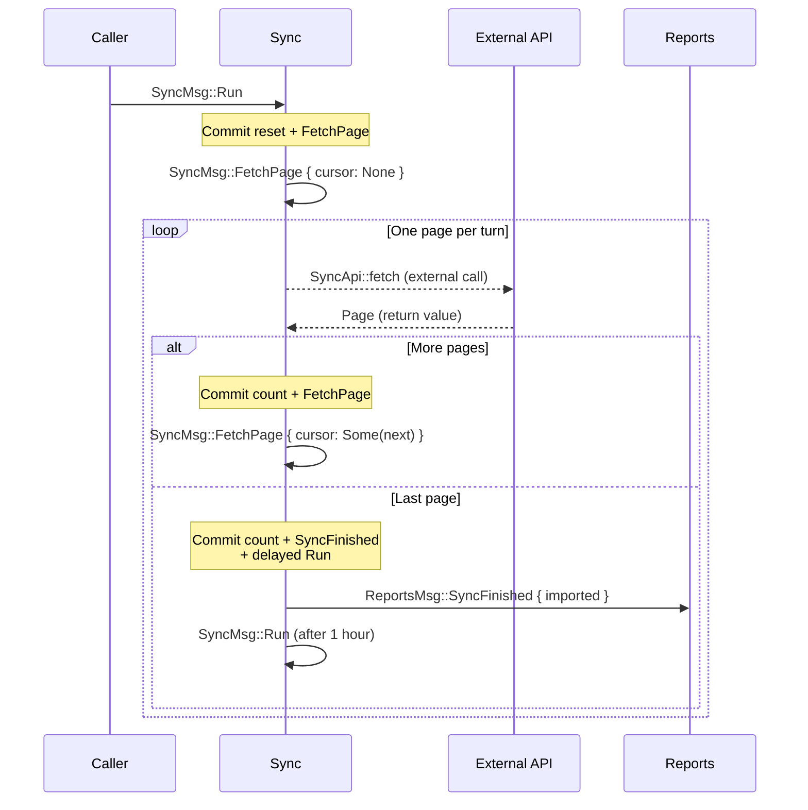
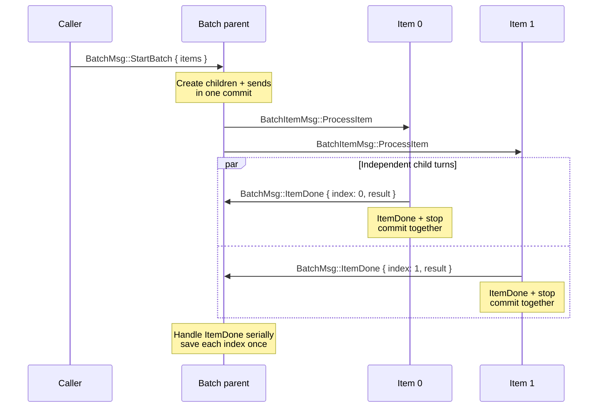
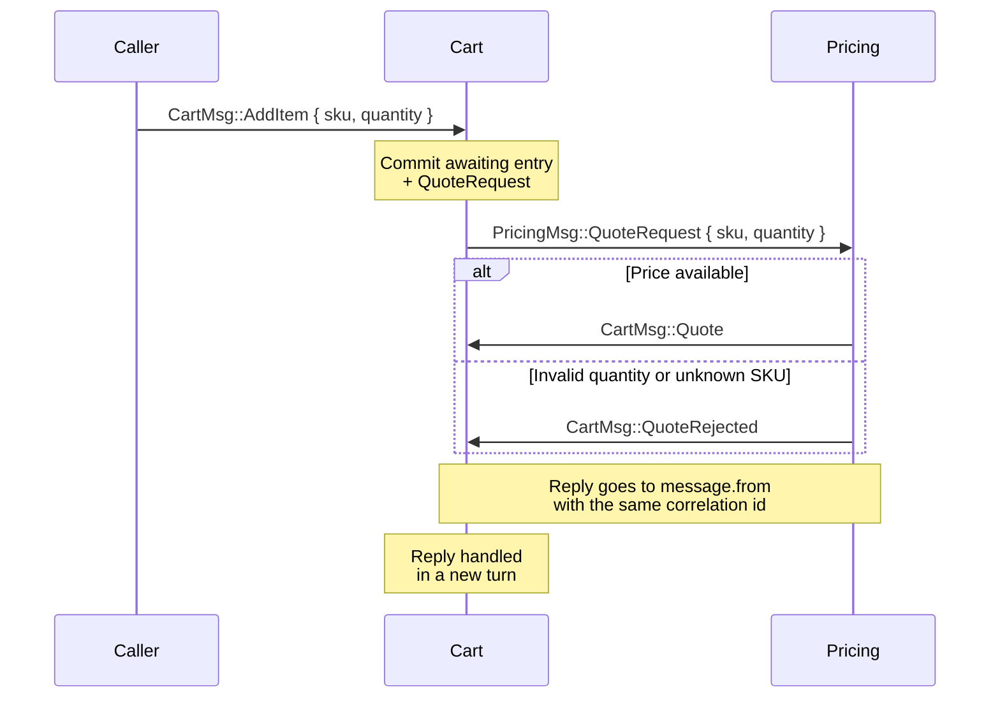
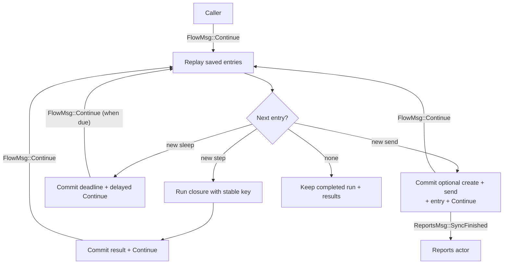
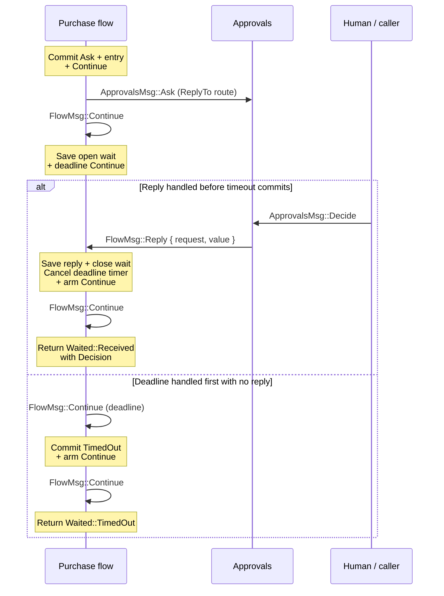

# Actor examples, visually

Follow the messages to see where work runs and where progress becomes durable.
Arrows between actors name queued message variants. Dashed arrows to/from an external API are calls and return values,
not actor messages; those calls can repeat after a crash.

## Paged import

[sync.rs](../../examples/src/sync.rs) processes one page per turn. Each commit saves the count and queues the next page;
the last page reports the total and schedules the next run.

The external fetch uses the message id as its idempotency key. The diagram's cycle is a chain of committed turns,
not an in-memory loop that must stay alive.

## Fan-out and fan-in

[fanout.rs](../../examples/src/fanout.rs) creates one child per item in the parent's turn.
The children can run in parallel; the parent handles their replies one at a time.

Reply order is unspecified. The parent counts each index once; deleting it removes any children still running.

## Request and reply

[reply](../../examples/src/reply/) uses two ordinary messages. The caller records progress in state instead of
keeping a handler open while waiting.

This is a message convention, not a synchronous ask API. The responder knows the return address from the request.

## Durable flows

[flow_onboarding.rs](../../examples/src/flow_onboarding.rs) saves one new step result or sleep per turn.
Flows can also [send actor work](actors.md#sending-to-actors) atomically with a new journal entry.
Every execution starts at the top; saved entries replay without repeating their closures.

The closure can repeat if its turn never commits; the external service must deduplicate by the step key.
The send branch uses `ReportsMsg::SyncFinished` from [the send example](actors.md#sending-to-actors). It enqueues once
per committed entry and does not wait for the target to succeed.
See [flow rules](actors.md#flows) before changing entry ids, order or result types.

## Flow requests and replies

[flow_approval.rs](../../examples/src/flow_approval.rs) asks an actor for a human decision. Unlike the ordinary
cart/pricing protocol, the flow library saves the request and wait outcome. This purchase sets a one-week decision deadline.

Only the Continue after an outcome commits returns it to flow code. The target must send the reply itself.
Mailbox order decides the race: a reply handled first can win after the deadline. Timeout leaves target work running.
See [request and wait rules](actors.md#requests-and-reply-waits) for ignored replies and recovery.

For ready-made composition, see [supervision](actors.md#supervisor), [message processing](actors.md#message-processing),
and [events starting flows](actors.md#event).
