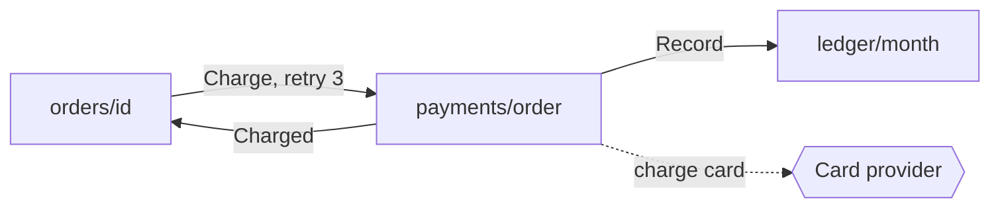

# Actor review: payments, the story "charge an order"

## Scope and sources

- **Requested scope:** the story "charge an order": `payments` (src/payment.rs), how `orders` requests a charge
  (src/order.rs) and the card provider client (src/gateway.rs); **excluded:** the ledger's own handlers, refunds.
- **Consumer code:** src/payment.rs, src/order.rs, src/gateway.rs at revision 4f2a9c1, no local changes.
- **Cicada source:** cicada 0.19.2 from crates.io (resolver status `ok`).
- **Skills:** actor-design 0.19.4, cicada 0.19.4; match.

## Progress

Phase: done
Pending questions: none
Evidence snapshot: revision 4f2a9c1, clean; cicada 0.19.2 from crates.io; 2026-11-10.

## Reconstructed system

Solid arrows are messages a turn commits; the dashed arrow is an outside call during the turn.

## Coverage

| Area | Verdict | Evidence or reason |
| --- | --- | --- |
| Ownership | supported | One payment actor per order owns its charges (observed, src/payment.rs:10). |
| Identities and lifecycle | finding R-002 | The month's ledger may not exist when a charge commits. |
| State and bounds | supported | At most three charges per order (user answer, 2026-11-10); see R-003. |
| Protocols | supported | Charged names the receipt. |
| Coordination and time | not applicable | No deadline in this story. |
| Recovery | finding R-001 | A retried Charge calls the provider again. |
| Outside effects | finding R-001 | The provider call has no key. |

## Findings

### R-001 A retried charge charges the card again

- **Priority:** high, because a customer pays twice and the charge cannot be undone by the service. **Status:** open
- **Evidence:** observed: src/payment.rs:45 calls `charge(&card, amount_cents)` without a key; src/gateway.rs:1 says
  the client never sends `Idempotency-Key`; src/order.rs:13 sends Charge with a retry policy of 3 attempts.
- **Trace:** payments/o-17 holds no charge. Charge (message m1) runs; the provider charges the card; the response
  times out, so `charge` returns an error and the turn fails. The policy reruns m1, which charges the card again.
- **Consequence:** two charges for one order; the state records one.
- **Correction:** send the message id as the provider's `Idempotency-Key`.
- **Check:** a TestActors test with a gateway double that fails after recording the call: one recorded charge per key.
- **History:** first reported at 4f2a9c1.

### R-002 A missing monthly ledger rejects the charge's commit

- **Priority:** medium, because the charge stays unrecorded until someone reconciles it by hand. **Status:** open
- **Evidence:** observed: src/payment.rs:52 sends Record to `ledger/<month>`, which a monthly job creates (comment,
  src/payment.rs:51); a send to an absent actor rejects the commit, and a rejected commit is not retried.
- **Trace:** on the 1st at 00:02 the ledger of the new month does not exist. Charge runs, the provider charges, the
  commit is rejected: no state, no Charged to the order, no retry.
- **Consequence:** money taken, the order never hears of it.
- **Correction:** create the month's ledger in the same commit when it is absent, or record through an owner that
  always exists.
- **Check:** a TestActors test that charges before the ledger exists.
- **History:** first reported at 4f2a9c1.
- **User note (Dana, 2026-11-11):** the monthly job runs at 00:05 on the 1st, so this window is five minutes. Keep open.

### R-003 Receipts grow without a bound

- **Priority:** low. **Status:** withdrawn: an order allows at most three charges (user answer, 2026-11-10).
- **History:** reported and withdrawn at 4f2a9c1.

## Accepted tradeoffs

- One payment actor per order rather than one per customer: charges of one customer run in parallel, accepted by the
  user because orders are independent.

## Open questions

None.

## Checks and limits

Read: src/payment.rs, src/order.rs, src/gateway.rs. Ran: nothing. Tests read: none exist for payments. The ledger's
handlers are out of scope.

## Next actions

- Fix R-001 first, then R-002.
