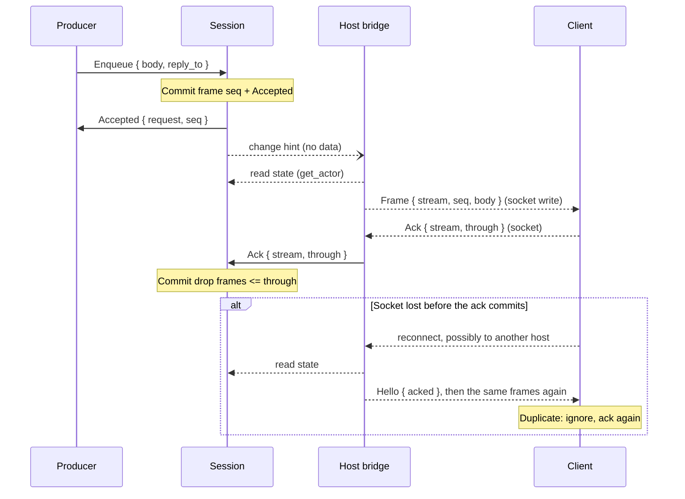
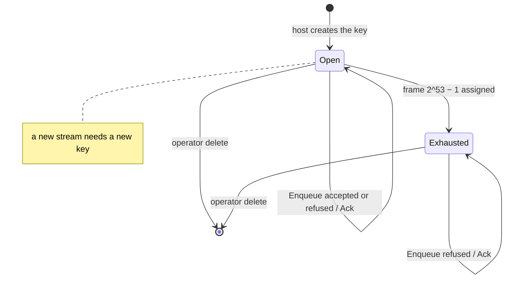

# Docs handoff for actor-design-guide

Version: 0.19.2. Refresh the dependency pins of `docs/how-to/install.md` once it is published.

## What changed

No library API, guarantee, wire format, contract hash or schema changes. New for users:

- **Example 20, a websocket session** (`examples/src/websocket_session.rs`, `examples/src/websocket_session/`,
  `examples/examples/websocket_session.rs` and `.html`, tests in `examples/tests/websocket_session.rs`). Public items:
  `Session` (`ws.sessions`), `SessionMsg::{Enqueue, Ack}`, `SessionState { assigned, acked, frames }`, `Frame`,
  `Refusal::{InvalidBody, BufferFull, SequenceExhausted}`, `SessionActor`; `Producer` (`ws.producers`),
  `ProducerMsg::{Emit, Accepted, Rejected}`, `ProducerState`, `Pending`, `Answer`, `ProducerActor`;
  `emit_and_wait`, the demo's emit from outside an actor, which waits for the Emit's own outcome and then for the
  answer it caused, and returns a refused send, a failed Emit or the time limit as an error; the constants
  `MAX_FRAMES` (100), `MAX_BODY_BYTES` (1024) and `MAX_SEQ` (9007199254740991); `bridge::{serve, SessionStore,
  ServerMessage, ClientMessage, Inbound, Closed, POLL_INTERVAL, IO_TIMEOUT}`; `adapter::{router, MAX_INBOUND_BYTES,
  MAX_WRITE_BUFFER_BYTES}`.
- `SessionStore` is implemented for `ActorSystem` with public operations only: `get_actor`, `send` and `changes`.
- The examples crate turns on axum's `ws` feature; its tests use `tokio-tungstenite` 0.29.
- `skills/cicada/SKILL.md` gets a row for live handles held by a host, and the routes to the nine guide headings.
- `examples/build.rs` and `examples/src/lib.rs` compile the Rust blocks of `docs/guide/design.md` as
  `DesignGuideDoctests`. This needs the file: see Blocking.

Tests that prove the example (all on paused virtual time with `TestActors`, no real sleeps):

| Behaviour | Test in `examples/tests/websocket_session.rs` |
| --- | --- |
| Accept: frame, reply and completion in one commit; the reply names the Enqueue's id | `an_accepted_body_becomes_the_next_frame_and_its_reply_names_the_request` |
| A producer holds one request in flight | `a_producer_keeps_at_most_one_request_in_flight` |
| 1024 UTF-8 bytes, not characters | `the_body_limit_counts_utf8_bytes` |
| 100 frames; an ack frees space | `a_full_buffer_refuses_until_an_ack_frees_space` |
| Precedence InvalidBody, BufferFull, SequenceExhausted; nothing changes | `refusals_follow_their_precedence_and_change_nothing` |
| The last sequence is exact as a JSON number and a double | `the_last_sequence_is_exact_in_json` |
| Only a new ack of this stream within the assigned range trims | `only_a_new_ack_within_the_assigned_range_of_this_stream_trims` |
| A missing reply actor rejects the commit; no frame | `a_missing_reply_actor_rejects_the_commit_and_keeps_no_frame` |
| An uncertain send repeats its id; one frame | `an_uncertain_send_repeats_its_id_and_appends_once` |
| NUL: `OpError::Invalid` and `TurnError::Invalid`, nothing queued, no reply | `nul_is_refused_at_submission_before_the_session_can_answer` |
| The demo's emit waits for its own Emit when turns run late, and sees a fast answer | `the_demo_emit_waits_for_the_answer_to_its_own_emit_when_turns_run_late` |
| The demo's emit reports a refused send, a failed Emit and its limit | `the_demo_emit_reports_a_refused_or_failed_emit_and_the_limit` |
| Socket JSON | `the_socket_messages_are_tagged_json` |
| Hello, retained frames, then new output by hint | `a_socket_gets_hello_then_the_retained_frames_then_new_output` |
| Disconnect before ack replays from the durable ack | `a_disconnect_before_the_ack_replays_from_the_durable_ack` |
| Lost or stalled ack send closes; reconnect replays | `a_lost_ack_closes_and_the_reconnect_replays` |
| Reconnect through a second `ActorSystem` on the same store, hints included | `another_system_on_the_same_store_serves_the_reconnect` |
| Overlapping sockets; stale acks harmless | `overlapping_sockets_of_one_client_get_the_output_and_stale_acks_are_harmless` |
| Missed hints recovered by the periodic read | `the_periodic_read_recovers_missed_hints` |
| Resync reads at once; other addresses under the literal prefix are skipped | `a_resync_reads_at_once_and_hints_of_other_addresses_are_skipped` |
| Stalled write closes after 5 s; output kept | `a_stalled_write_closes_after_the_timeout_and_keeps_the_output` |
| Failed or stalled read | `a_failed_or_stalled_read_closes_before_hello` |
| Missing or deleted session | `a_missing_or_deleted_session_closes_the_socket` |
| A reused key | `a_key_used_for_a_new_stream_closes_the_socket` |
| Feed end and a closed store | `the_end_of_the_feed_closes_the_socket` |
| Shutdown stops and joins both halves | `shutdown_stops_both_halves` |
| Binary, malformed or non-integer input | `invalid_input_closes_the_socket` |
| The axum route: real handshake, JSON, ack and close code 1003 | `the_axum_route_serves_the_session_over_a_websocket` |

## 1. The design guide

**Where.** A new file `docs/guide/design.md`, title `Design with actors`. Its nine headings, exactly (the skill routes
to these anchors): `From problem to design`, `Choose actors and identities`, `Design protocols`,
`Coordinate work and time`, `Recover from failure`, `Work with outside systems`, `Choose a pattern`,
`Recognize design mistakes`, `A websocket session`.

**Text.** Method (E1): each section tells a small domain story, names the principle, then gives its Cicada form and
links the checked example or API section. API detail stays in the layer guides. Diagrams are Mermaid. The source
of the substance is `openspec/changes/actor-design-skill/research/actor-design.md` (principles, nine steps,
patterns, mistakes) and `cicada-fit.md` (the Cicada form of each idiom), checked against `docs/architecture.md`;
the qualifications under Caveats are binding. The intro: this guide is for deciding which actors exist, what each
owns and what they say to each other before handlers are written; `core.md#design-an-actor` stays the short rule
set for one actor type.

### `From problem to design`

The nine steps, each with its question and its written result, as a table (from the research's section 2):

| Step | Ask | Write down |
| --- | --- | --- |
| 1. The promise | What does the user get: success, refusal, cancellation, unknown? What must never happen? Which effects cannot be undone? Would a design without actors do? | A short contract and the hard limits |
| 2. Who and what | Which facts happen, caused by what? What acts on its own: customers, sessions, devices, jobs? What is authoritative, derived or suspected? | A timeline of the domain |
| 3. Who owns each rule | Which data must one decision see together? Can one owner refuse a conflicting command alone? | A map from rule to owner |
| 4. Identity and life | What routes two requests to the same actor? Can a key come back? Who creates and ends it; what happens to children, pending work and late replies? | Identity rules and a lifecycle sketch |
| 5. Responsibility cards | One sentence of purpose per actor; what it decides, owns, only observes and does not own; what grows | One card per actor |
| 6. Protocols | Command, event, query or reply? What names the work, the conversation, the reply address, the deadline? What does each acknowledgement prove? | A message table and a state table per actor |
| 7. Coordination and time | Draw success, timeout, repeat, reorder, cancel, a failed dependency. Who records progress and picks the recovery? | Sequence diagrams with failure branches |
| 8. The outside | Who decides an outside action? What names it across retries? What if it happened but was not recorded? | An effect list and a plan to reconcile |
| 9. Check and simplify | Can a short trace break a rule or orphan accepted work? Which actors only forward and could be functions? | Counterexample traces and the simplifications |

Then one worked pass, short, on the websocket story of the last section: step 1 "every accepted line reaches the
client's screen once, in order, even across reconnects; nothing accepted is dropped silently"; step 3 the session
owns sequence, buffer and acknowledgement; step 4 one key per stream life, created by the host, never reused; and
so on, ending with the responsibility card below. Say plainly that a simpler design (a function, a table with a
transaction, a read model) is the right answer when no rule needs one owner over time; a mixed system is normal.

Responsibility card, as a table, for the session: identity `ws.sessions/<stream>`, one stream life of one logical
client; purpose "keep what the client has not processed"; decides acceptance or refusal and the order of frames;
protects "no accepted frame is lost before the client acknowledges it" and "sequences are contiguous"; messages
`Enqueue`, `Ack`; emits `Accepted`, `Rejected`; works with the producer and the host bridge; lifecycle created by the
host, ended by an operator delete; bounds 100 frames, 1024 bytes, 2^53 − 1 sequences; outside effects none (the host
writes the socket); recovered by nobody: a failed turn commits nothing.

### `Choose actors and identities`

Story: an order with lines and a stock count. Principle: one rule, one owner; size an actor to its rule; find actors
in the problem (things that act at the same time, lasting identities, resources needing one authority), not in
classes or tables. Cicada form: a type plus a key; the turn is the transaction (G1, G2); a turn cannot read another
actor's state, so a rule over two actors is agreement by messages. Keys: stable business ids; a composite key is one
string (`examples/src/fanout.rs`); a reused identity gets a new key when work from an old life can still arrive
(a delete purges the mailbox and fences old turns, but outside work of the old life can land; ADR 0024). Who creates
each actor must be in the design: a send to an absent actor fails the sender's commit. Parent and child
(`create_child`) for cleanup, watches for recovery: two separate relations. Bounded state: keep bounded history,
child actors or references (`examples/src/fanout.rs`, `examples/src/registry.rs`). A singleton serializes all its
work (`examples/src/singleton.rs`). An actor map in Mermaid (`flowchart`) with actors as nodes, arrows labelled by
message variant, and the host and the outside service drawn differently.

### `Design protocols`

Story: a cart asking for prices. Principle: messages are the contract; define requests, outcomes and the rules of
the conversation before handlers; a refusal is data, a fault is failure. Cicada form:

- Request and reply are two messages. Reply to `message().from` with `send_to` and the correlation id
  (`examples/src/reply/`), or carry a typed ref in the request (`reply_to: Order` in `examples/src/saga/`;
  `reply_to: Producer` in the websocket example). Flows have `ReplyTo<T>` (`actors.md#requests-and-reply-waits`).
- Every variant of a message enum is public: anyone who can send over HTTP can send it. Checking
  `message().from` is protocol validation between actors, not authentication; authentication belongs to the host.
- Three identities: the message id names the operation (a repeat within the retention window is a duplicate), the
  correlation id the conversation, `attempt` the try. Say what each acknowledgement proves: a stored send is not an
  accepted business request; only the application's reply says that.
- A business refusal is a reply variant (`QuoteRejected`, `Rejected { reason }`); `Err` is a fault, and
  `turn.fail(..)` refuses a message for good.
- A state table per actor, because the compiler checks every message, not every message in every state. Show the
  session's table:

| State \ message | `Enqueue`, body fits | `Enqueue`, refused | `Ack`, new and valid | `Ack`, other |
| --- | --- | --- | --- | --- |
| Any | Append frame `assigned + 1`, reply `Accepted` | Reply `Rejected`, no change | Drop frames `<= through`, set `acked` | No change |

- Invalid content Cicada refuses itself: a NUL character or a value deeper than 64 levels is refused when it is sent
  (`OpError::Invalid` from `ActorSystem`, `TurnError::Invalid` from a turn), so the receiver never gets it and sends
  no reply. An application limit (here 1024 bytes) is the receiver's refusal, sent as a reply.

### `Coordinate work and time`

Story: an order that reserves stock, charges and ships. Principle: across actors, agree by messages over time; time
belongs in the protocol: say when something expires, what happens to a late reply and who decides when completion
races a deadline; bound everything that grows. Cicada form: saga with compensation (`examples/src/saga/`); durable
steps (`examples/src/steps.rs`); flows for process managers and waits with deadlines (`actors.md#flows`); fan-out and
fan-in (`examples/src/fanout.rs`); timers with a generation number so a stale timeout is ignored
(`examples/src/timer.rs`); recurring work (`examples/src/cron.rs`, `actors.md#scheduler`). Deferred work is bounded
state: keep pending requests in state with a limit and refuse beyond it (`examples/src/flow_approval.rs` refuses
beyond 100; the websocket session refuses with `BufferFull`). Order: per actor, due time then arrival; never design
on order across senders or after a retry. A sequence diagram with a failure branch (`alt` timeout / late reply).
Qualification: sends are one-way, so a blocking call cycle cannot be written, but two actors that each wait for a
message the other never sends is still a logical wait cycle: give every wait a deadline.

### `Recover from failure`

Story: a payment gateway that fails. Principle: design who recovers what and which stable condition holds after; a
refusal is data, a fault is a failure; one retry owner with a budget. Cicada form: a failed turn commits nothing, so
state is always the last commit; the sender picks the retry (`core.md#retry`, G6); watches give `Failed` and
`Stopped` as messages (`core.md#watches`); the supervisor restarts one child and dead letters keep what failed
(`examples/src/supervision.rs`, `actors.md#supervisor`, `actors.md#dead-letters`). By hand, with existing APIs: a
group restart is a delete and create of several actors in one commit; a circuit breaker is breaker state and a timer
in the gateway actor, or a second actor that pauses and resumes it (`core.md#control-effects`). A lifecycle state
diagram (`stateDiagram-v2`) of a gateway: closed, open, half-open, with the timer.

### `Work with outside systems`

Story: sending an e-mail and writing a row in the application's database. Principle: your atomic step does not reach
the outside; sending is not doing, a timeout is not a no. Cicada form: effects inside the system happen once (G4);
the handler's code and its outside calls can run again. Give each outside call a stable key: the message id, a flow
step's key or a business id (`core.md#design-an-actor`). A write to the application's own database is an outside
effect: it is not part of the turn's commit; make it an upsert keyed by the message id, or put it in its own step.
Put separate turns between effects that must keep independent progress (`examples/src/steps.rs`). Keep an effect's
"unknown" state in the actor's state and reconcile by key on a re-run.

Live handles: a socket, child process or device handle cannot live in actor state, and an actor keeps nothing
between turns except its state; host-held dependencies on the actor struct (a client, a handle table) can hold
memory, but that memory is the node's, not the actor's. Two forms:

1. **A turn uses a handle kept by its host.** The actor struct holds a table of handles by key; the state holds what
   should be true and what was last seen. This works today only when one node hosts the type: any hosting node may
   run the next turn. Cover node restarts (the table is empty while state says running), a turn that acted and did
   not commit, and stale events of an old incarnation.
2. **A host task follows the actor's durable state.** The actor holds what should be true; a task on the machine
   that has the handle subscribes to change hints, reads the state, acts on the handle and reports back as messages.
   It works on any number of nodes without a pin. The websocket session is this form.

Do not imply that actor pinning exists: the many-node form of 1 is a later change.

### `Choose a pattern`

A compact table, one row per pattern, with when it fits, its cost and the example:

| Pattern | Fits when | Costs | Example |
| --- | --- | --- | --- |
| Plain actor per entity | One rule, one owner | One commit per message | `examples/src/registry.rs` |
| Request and reply | One actor needs another's decision | Two messages, a correlation id, a late-reply rule | `examples/src/reply/` |
| Saga | Several steps must all happen or be undone | Compensation for every step; intermediate states are visible | `examples/src/saga/` |
| Durable steps | Effects that must keep independent progress | One turn per step | `examples/src/steps.rs` |
| Flow | Long processes with waits and deadlines | A journal; replay rules | `examples/src/flow_onboarding.rs`, `examples/src/flow_approval.rs` |
| Timer | A deadline or retry later | A generation to ignore stale timeouts | `examples/src/timer.rs` |
| Supervision | A child must come back to its first state | Restart loses the child's state on purpose | `examples/src/supervision.rs` |
| Outside service | A call that may repeat | An idempotency key; reconcile on unknown | `examples/src/sync.rs`, `examples/src/steps.rs` |
| Host follows state | A live handle on any node | A poll and reconnect logic in the host | `examples/src/websocket_session.rs` |
| Ready-made actors | Limits, debouncing, batching, schedules, topics | Their contracts | `actors.md` |

### `Recognize design mistakes`

Each as symptom and correction, no new runtime feature:

| Mistake | Symptom | Correction |
| --- | --- | --- |
| A rule split over actors | Two owners disagree; compensation everywhere | Move the data of the rule into one actor, or make the agreement an explicit saga |
| One actor for all traffic | Its mailbox grows; everything waits | Key by the natural unit; a singleton only for truly global, rare work |
| Unbounded state | State and turns get slower; a 64-level or size limit is hit | Bound history, use children or references, refuse beyond a limit |
| Assumed message order | Works in tests, fails under retry or two senders | Carry versions or sequences; design each state for any arrival order |
| Unclear acknowledgement | Callers treat "stored" as "done" | Name what each reply proves; reply with the business result |
| A wait cycle | Two actors wait for each other forever | Give each wait a deadline and an owner of the timeout |
| Outside effects unsafe to repeat | Double charges or e-mails after a lost claim | Key by message id or business id; one effect per turn; reconcile |

Qualify: G4 makes effects inside the system happen once; it does not deduplicate a business request submitted twice
as two messages (give it a stable message id or a business key), nor any outside effect.

### `A websocket session`

The end-to-end story, one stream life:

1. The host authenticates the user and creates `Session { stream }` with `SessionState::default()` under a fresh key;
   one logical client per session; independent tabs or devices get their own sessions. The host's authorization
   decides who may open the socket; knowing a key or being the sender of a message proves nothing.
2. A producer sends `Enqueue { body, reply_to }`. The session appends frame `assigned + 1` and replies
   `Accepted { request, seq }` in one commit, `request` being the Enqueue's message id; or replies
   `Rejected { request, reason }` with `InvalidBody` (more than 1024 UTF-8 bytes), `BufferFull` (100 unacknowledged
   frames) or `SequenceExhausted` (2^53 − 1 reached), in that order, and changes nothing. No eviction, no retry. The
   demo producer holds one request in flight and records the last answer.
3. The host bridge subscribes to the session's hints, reads at once, writes `Hello { stream, acked }` and the frames
   above `acked`, and reads again on a hint of the exact address, on `Resync` and every second.
4. The client applies only the next contiguous frame, persists its cursor per stream, acknowledges with
   `Ack { stream, through }`; the host forwards it as an ordinary message; the session drops frames up to `through`.
5. On reconnect (any host on the same store) the client gets `Hello` and the unacknowledged frames again, ignores
   what it applied, acknowledges again and goes on.

Diagrams (proposed):



Solid arrows are committed actor messages; dashed arrows are host reads, hints and socket I/O, which are outside
effects and can repeat.



The host side in Rust, as a `no_run` doctest of `DesignGuideDoctests` (taken from
`examples/examples/websocket_session.rs`; the router lives in `examples/src/websocket_session/adapter.rs`):

```rust,no_run
use cicada::ActorSystem;
use cicada_examples::websocket_session::adapter;
use tokio_util::sync::CancellationToken;

async fn serve_sessions(system: ActorSystem) -> anyhow::Result<()> {
    let shutdown = CancellationToken::new();
    // Put the host's own authentication in front of this router.
    let app = adapter::router(system, shutdown.clone());
    let listener = tokio::net::TcpListener::bind("127.0.0.1:0").await?;
    axum::serve(listener, app).with_graceful_shutdown(shutdown.cancelled_owned()).await?;
    Ok(())
}
```

The minimal browser client is `examples/examples/websocket_session.html`; show its `onmessage` handler (about 25
lines of JavaScript): ignore callbacks of an older connection generation; on `Hello`, stop when `acked` is above the
stored cursor (those frames are gone), otherwise ack again; on `Frame`, ack again a `seq` at or below the cursor,
reconnect on a gap, and otherwise apply, store the cursor, then ack. Run it with
`cargo run -p cicada-examples --example websocket_session` and open the printed page.

**Caveats.** (Binding; these are the example's application convention, not Cicada guarantees.)

- No exactly-once processing in the client: a frame applied before its cursor was stored is applied again.
- A cursor lost behind `Hello.acked` cannot be rebuilt: acknowledged frames are not history. The application
  recovers by other means or starts a new session.
- The host keeps no socket registry and fences no socket: an old socket may still deliver bytes; acks of the same
  logical client are monotone, so they are harmless. The client's connection generation ignores the old callbacks.
- A per-socket sent cursor only avoids repeats within one socket; it is never evidence. Replay needs a live store,
  running session handlers, a reconnecting client and no deletion or purge: a delete or purge ends the promise for
  what was removed. Nothing expires on its own.
- The buffer bound does not bound the mailbox or the number of sessions.
- A sent message is not an accepted frame; an unknown send outcome is retried with the same message id within the
  deduplication window (7 days by default); there is no permanent business deduplication.
- Change hints are best effort: memory and SQLite cover one `Store` and its clones (the second-system test shares a
  memory store); PostgreSQL covers upgraded nodes on one schema. The one-second read covers everything else.
- The route authenticates nobody; inbound messages and frames are limited to 4 KiB, writes to 16 KiB buffered and
  flushed per message; binary or malformed input closes the socket (close code 1003).
- No browser run was checked: the HTML client is exercised by reading only. The Rust adapter is checked by a real
  websocket handshake in the tests.

## 2. Navigation

**Where and text.** Keep every existing anchor.

- `README.md`, `Documentation`: one sentence after "Start here": the design guide for deciding actors, ownership and
  protocols before writing handlers (`docs/guide/design.md`).
- `docs/README.md`, `Solve a task`: a row "Design a system of actors: boundaries, protocols, recovery" to
  `guide/design.md`, and a row "Serve a live socket from durable state" to `guide/design.md#a-websocket-session`.
- `docs/agents.md`, `Read only what the task needs`: a row "Design actors and protocols" | `guide/design.md` |
  `../examples/src/websocket_session.rs`.
- `docs/guide/core.md`, `Design an actor`: one sentence at the start: for choosing several actors and their
  protocols, read `design.md`; this section is the rule set for one type. `Examples`: a row "Websocket session: a host
  follows durable output" to `../../examples/src/websocket_session.rs`.
- `docs/guide/patterns.md` (optional): link the websocket sequence diagram from the guide rather than copying it.

## 3. Guarantee row G2

**Where.** `docs/guarantees.md`, row `G2 Atomic`.
**Text.** Add `examples/tests/websocket_session.rs::an_accepted_body_becomes_the_next_frame_and_its_reply_names_the_request`
and `examples/tests/websocket_session.rs::a_missing_reply_actor_rejects_the_commit_and_keeps_no_frame`: the frame, the
reply and the completion commit together, and a rejected commit keeps no frame. No new G or S guarantee.

## Blocking

Resolved by the owner's prepared docs, folded into `Wire the design guide's doctests and routes`, the commit that
needed them (ADR 0045); no commit of the branch has the break. Owner commit `147f05ae2d1395f5c360b5c8bf3e6b3bb76f609b`
on `docs`, taken as whole files without a merge: `README.md`, `docs/README.md`, `docs/agents.md`,
`docs/guide/core.md`, `docs/guide/design.md` (new) and `docs/guarantees.md`. They held:

1. `docs/guide/design.md` for `DesignGuideDoctests` (`examples/build.rs`), with the nine headings the skill routes
   to and `REQUIRED_ROUTES` requires, and one `no_run` Rust block.
2. The navigation of section 2 and the G2 tests of section 3.

## Status

Checked on the combined result: `cargo test -p cicada-examples --doc` (30 passed), `--test docs` (11 passed),
`--test skill` (10 passed), `--test websocket_session` (28 passed, after review fix 1: the demo's emit); before it `cargo clippy -p cicada-examples
--all-targets -- -D warnings`, `cargo check -p cicada-examples --examples`, `bash scripts/ci/dependency-trees.sh`
and a manual run of the demo (an HTTP 101 upgrade, then `Hello` and the frames over `curl`). The gate result is in
the build report. The guide, navigation and G2 prose are the owner's; nothing is left to write for this change. Review fix 1
(`emit_and_wait`) changes no prose: the guide's demo text ("keeps one request in flight and records the last
answer", `cargo run`, the printed URL) stays true. No
browser execution was checked.
