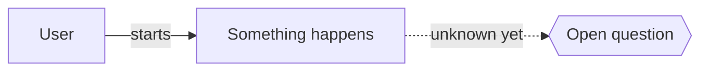
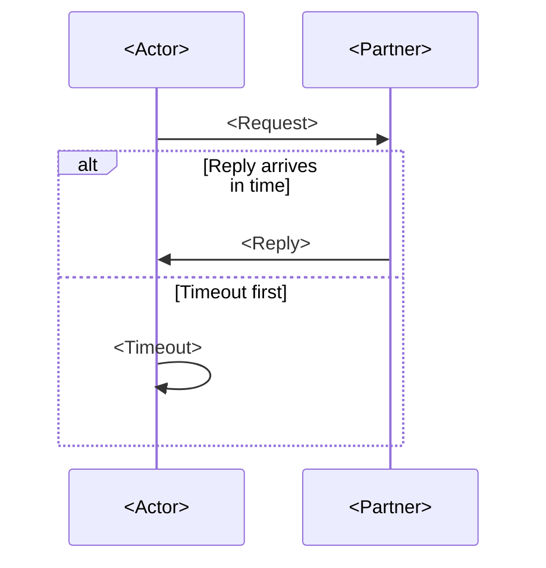

# Actor design: <system name>

<One sentence: what this system does for whom.>

## Source and scope

- **Cicada source:** <version, Cargo source and revision as the resolver reports them; or "not chosen yet">
- **Selection examined:** <manifest path, target and features>
- **Skills:** actor-design <version>, cicada <version>; <match, difference, or not comparable>
- **Not verified:** <what could not be read or checked, such as a missing design guide at this version>
- **In scope:** <the part of the system this design covers>
- **Out of scope:** <what it leaves to other designs or systems>

## Progress

Current step: 1. The promise

Next question: <the next question to ask the user>

| Step | Status |
| --- | --- |
| 1. The promise | not started |
| 2. Who and what | not started |
| 3. Who owns each rule | not started |
| 4. Identity and life | not started |
| 5. Responsibility cards | not started |
| 6. Protocols | not started |
| 7. Coordination and time | not started |
| 8. The outside | not started |
| 9. Check and simplify | not started |

Status is one of: not started, draft, confirmed, delegated, needs review.

## 1. The promise

<Stories: one or two concrete stories, each with a way it goes wrong, in the user's words.>

<A short contract: success, refusal, cancellation, unknown. What must never happen. Which effects cannot be undone.
Whether a design without actors would do, and why or why not.>

## 2. Who and what

<A timeline of the domain: the facts, what causes each, who acts independently, and which facts are authoritative,
derived or suspected.>

## 3. Who owns each rule

| Rule | Data it needs together | Owner |
| --- | --- | --- |
| <rule> | <data> | <owner> |

## 4. Identity and life

| Actor | Key | Who creates it | Who ends it | Can a key return? |
| --- | --- | --- | --- | --- |
| <actor> | <key> | <creator> | <end> | <yes or no, and what happens to old messages> |

## 5. Responsibility cards

| <Actor> card | Decision |
| --- | --- |
| Identity and purpose | <key and one sentence> |
| Decides | <what it alone decides> |
| Protects | <the rules it keeps> |
| Messages and replies | <what it receives and sends> |
| Partners | <who it works with, and who owns what> |
| Lifecycle | <creation and end> |
| Bounds | <what grows, and its limit> |
| Outside effects | <none, or which and who decides them> |
| Recovery | <who recovers it and what recovery restores> |

## 6. Protocols

| Message | Kind | From | To | Names the work by | Reply or proof |
| --- | --- | --- | --- | --- | --- |
| <message> | <command, event, query or reply> | <sender> | <receiver> | <id or key> | <what an answer proves> |

| State | Message | Result |
| --- | --- | --- |
| <state> | <message> | <result> |

## 7. Coordination and time

<One sequence per story: success, then timeout, repeat, reorder, cancellation and a failed dependency, or why a
branch does not apply. Mark host calls outside a turn and what one turn commits together.>

## 8. The outside

| Effect | Who decides it | Names it across retries | If it happened but was not recorded |
| --- | --- | --- | --- |
| <effect> | <actor or host> | <key> | <how to reconcile> |

## 9. Check and simplify

<Short traces that try to break a rule or leave accepted work without an owner, and what they showed. Actors that only
forward and could be functions.>

## Decisions

| Decision | Reason | Decided by | Still uncertain |
| --- | --- | --- | --- |
| <decision> | <why> | <user, or delegated> | <what remains open> |

## Open questions

- <A hypothesis or missing requirement, labelled, with the step it affects.>
